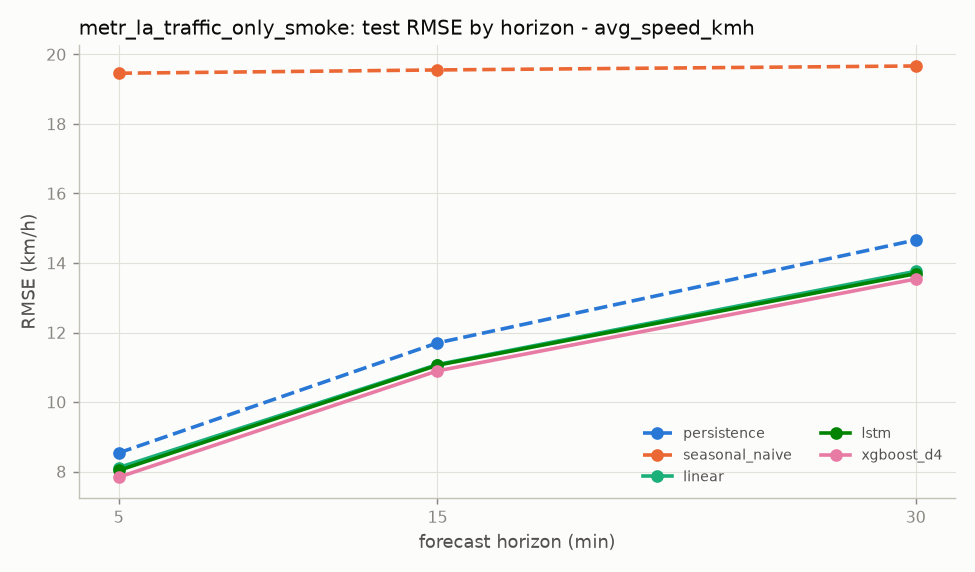
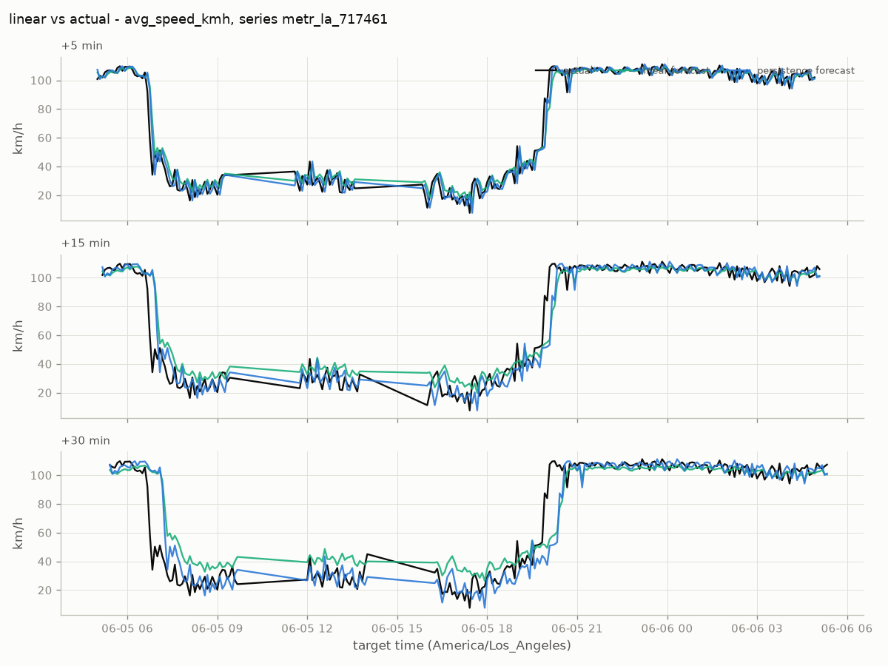
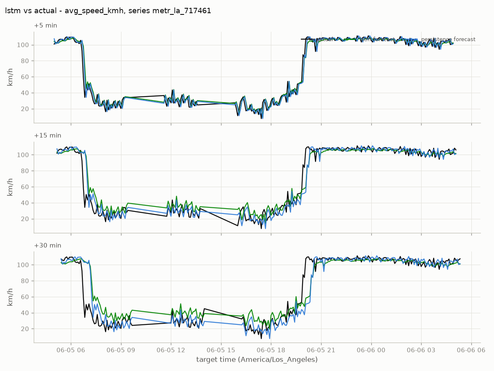
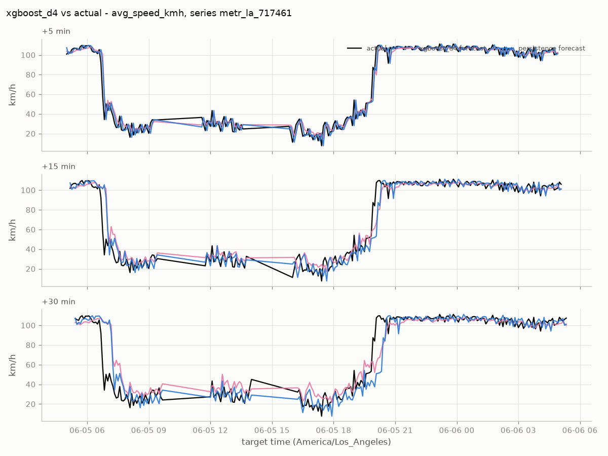

# Forecasting experiment `20260925-020100_metr_la_traffic_only_smoke`

METR-LA speed forecasting at +5/+15/+30 min (traffic only: past speeds of the sensor). Chronological split, fit-on-train scaling, identical windows for every model.

- **Dataset:** metr_la (metr_la), 11 series, resolution 300 s
- **Periods (chronological):** train 2012-03-01T08:00:00+00:00 -> 2012-05-23T14:30:00+00:00; val 2012-05-23T14:30:00+00:00 -> 2012-06-04T11:55:00+00:00; test 2012-06-04T11:55:00+00:00 -> 2012-06-28T07:00:00+00:00
- **Samples:** {'train': 240241, 'val': 32543, 'test': 61657} (identical test origins for every model)
- **Inputs (1):** avg_speed_kmh
- **Targets:** avg_speed_kmh; horizons [5, 15, 30] min
- **Model selection:** by validation RMSE on `avg_speed_kmh` -> **xgboost_d4**

## avg_speed_kmh (km/h) - test, averaged over horizons

| model | MAE | RMSE | R2 | MAPE | skill |
|---|---|---|---|---|---|
| xgboost_d4 | 6.311 | 10.8 | 0.782 | 10.7 | 0.076 |
| lstm | 6.409 | 10.9 | 0.775 | 10.9 | 0.060 |
| linear | 6.523 | 11.0 | 0.773 | 11.1 | 0.055 |
| persistence | 6.697 | 11.6 | 0.745 | 10.4 | 0.000 |
| seasonal_naive | 10.6 | 19.6 | 0.311 | 18.2 | -0.764 |

## avg_speed_kmh by horizon (test)

**+5 min**

| model | MAE | RMSE | R2 | MAPE | skill |
|---|---|---|---|---|---|
| xgboost_d4 | 4.792 | 7.838 | 0.889 | 7.475 | 0.082 |
| lstm | 4.940 | 8.032 | 0.884 | 7.659 | 0.059 |
| linear | 5.050 | 8.114 | 0.881 | 7.868 | 0.049 |
| persistence | 5.333 | 8.536 | 0.869 | 7.881 | 0.000 |
| seasonal_naive | 10.5 | 19.5 | 0.318 | 18.1 | -1.279 |

**+15 min**

| model | MAE | RMSE | R2 | MAPE | skill |
|---|---|---|---|---|---|
| xgboost_d4 | 6.275 | 10.9 | 0.786 | 10.5 | 0.069 |
| lstm | 6.396 | 11.1 | 0.780 | 10.9 | 0.055 |
| linear | 6.453 | 11.1 | 0.779 | 10.9 | 0.053 |
| persistence | 6.657 | 11.7 | 0.753 | 10.3 | 0.000 |
| seasonal_naive | 10.6 | 19.6 | 0.312 | 18.2 | -0.671 |

**+30 min**

| model | MAE | RMSE | R2 | MAPE | skill |
|---|---|---|---|---|---|
| xgboost_d4 | 7.867 | 13.5 | 0.669 | 14.0 | 0.077 |
| lstm | 7.891 | 13.7 | 0.662 | 14.1 | 0.066 |
| linear | 8.067 | 13.8 | 0.658 | 14.4 | 0.061 |
| persistence | 8.101 | 14.7 | 0.612 | 13.0 | 0.000 |
| seasonal_naive | 10.7 | 19.7 | 0.302 | 18.4 | -0.341 |

## Seed variability of deep models (avg_speed_kmh, test RMSE, mean over horizons)

| model | mean | std | min | max | seeds |
|---|---|---|---|---|---|
| lstm | 11.2 | - | 11.2 | 11.2 | 1 |

The tables above use, for each deep model, the seed with the best *validation* RMSE.

## Observations (derived automatically from the numbers above)

- +5 min: lowest test RMSE = **xgboost_d4** (7.838); persistence 8.536; linear 8.114
- +15 min: lowest test RMSE = **xgboost_d4** (10.9); persistence 11.7; linear 11.1
- +30 min: lowest test RMSE = **xgboost_d4** (13.5); persistence 14.7; linear 13.8
- Best deep model lstm vs best tree model xgboost_d4: RMSE 10.9 vs 10.8 (tree better by 1.6%).
- Best tree model xgboost_d4 vs linear baseline: +2.1% RMSE reduction.
- Models beating persistence on average: linear, lstm, xgboost_d4.
- Deep models whose mean-over-seeds RMSE (+1 std) is below the best tree model (xgboost_d4): none.

## Training cost

| model | family | fit (s) | predict (ms/sample) | epochs | parameters |
|---|---|---|---|---|---|
| persistence | baseline | 0.0 | 0.0001 | - | - |
| seasonal_naive | baseline | 0.0 | 0.0002 | - | - |
| linear | linear | 2.23 | 0.001 | - | - |
| lstm | deep | 3.42 | 0.0015 | 1 | 50755 |
| xgboost_d4 | tree | 3.8 | 0.0017 | - | - |

## Figures

