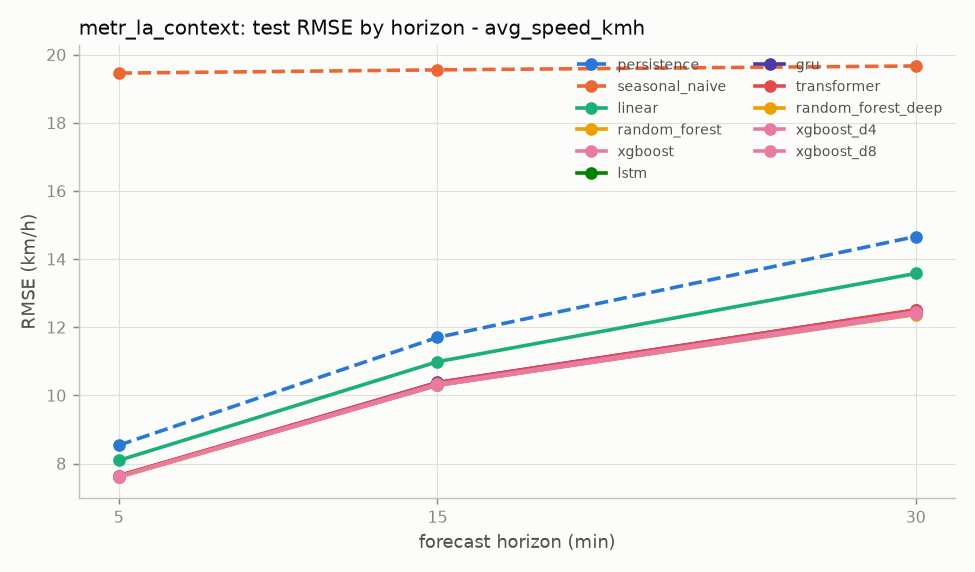
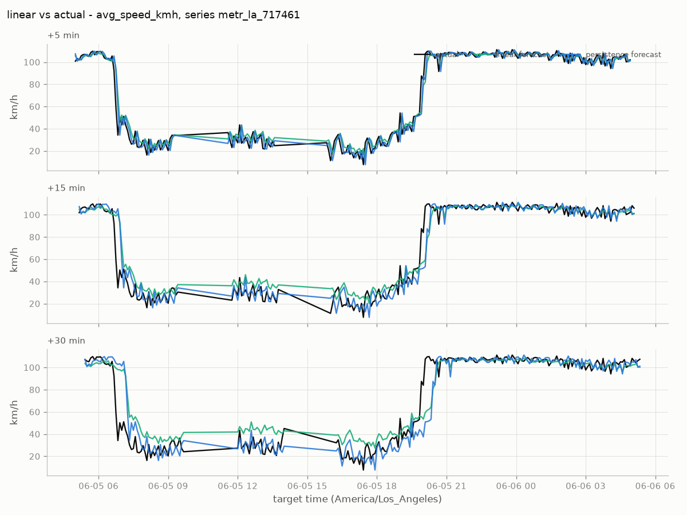
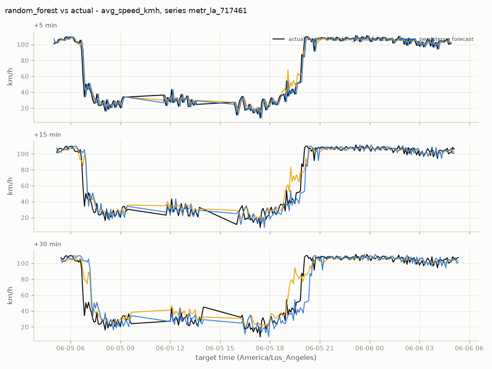
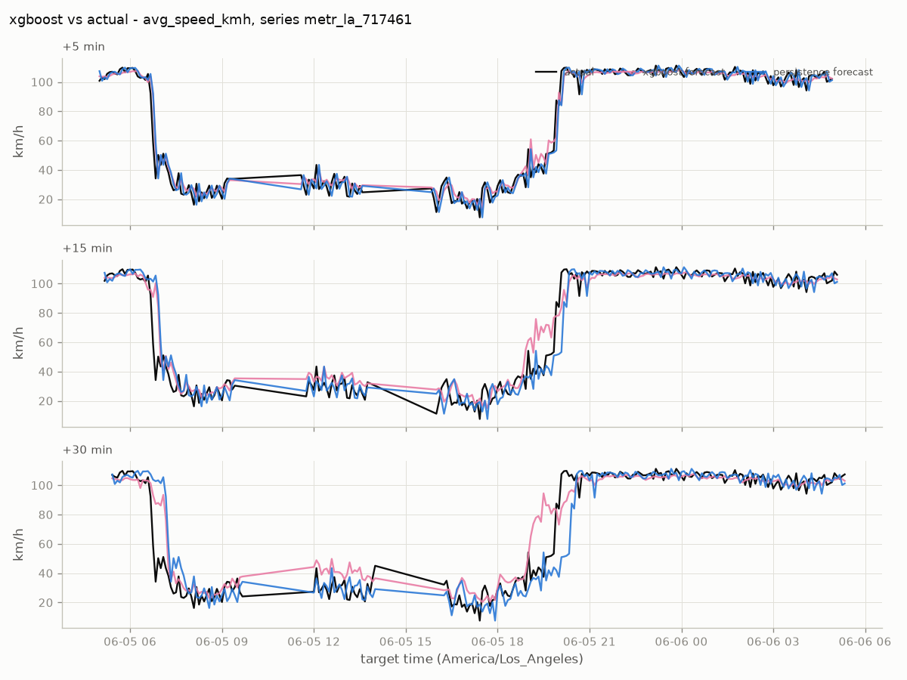
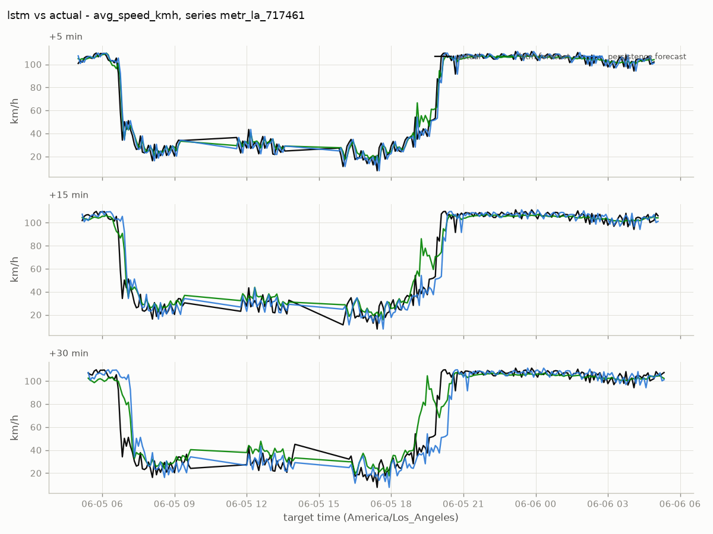
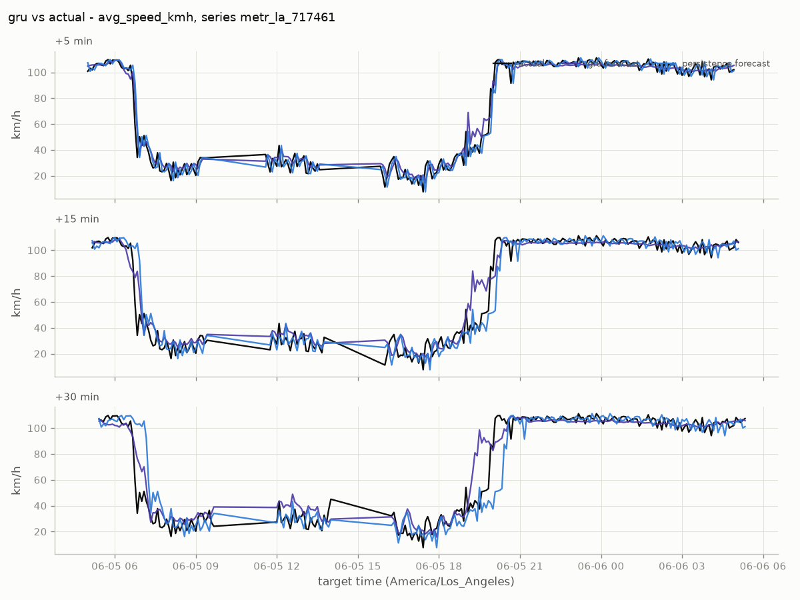
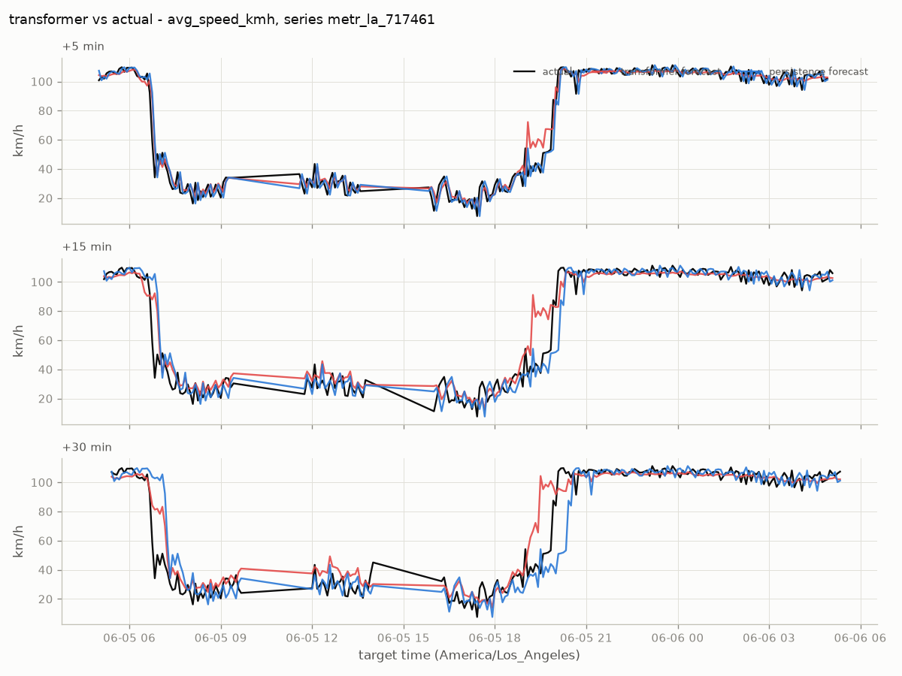
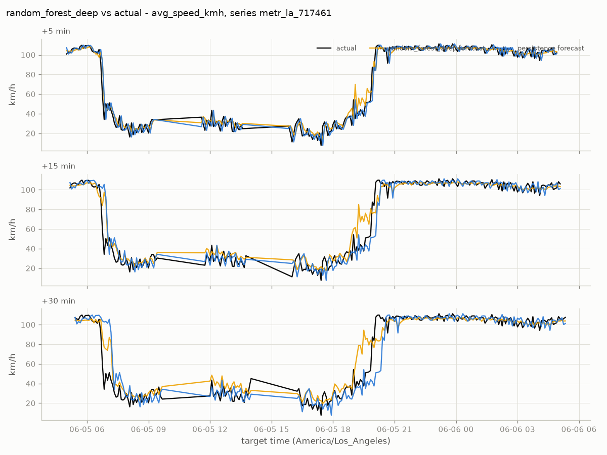
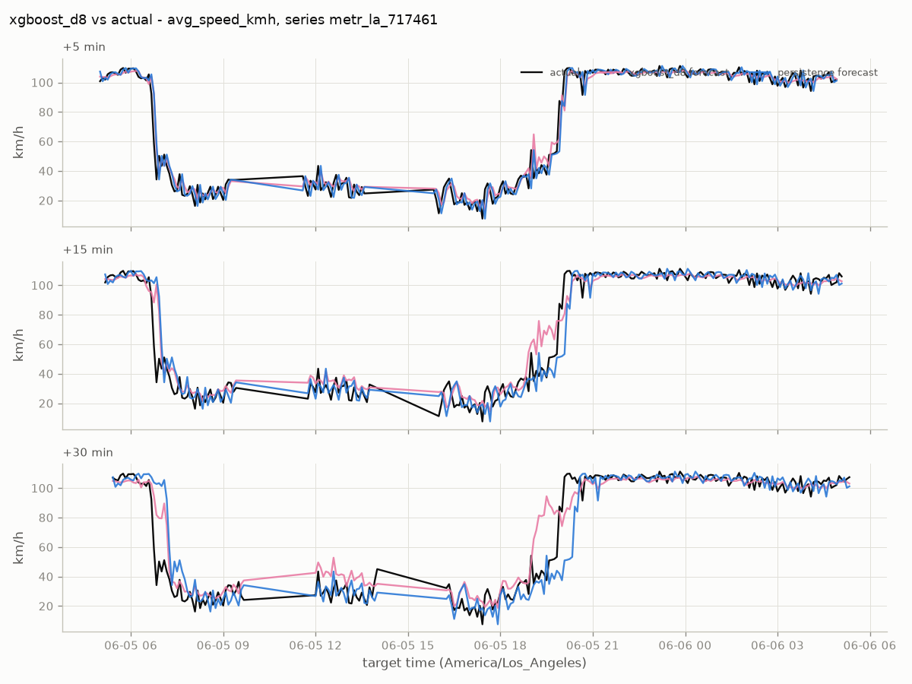

# Forecasting experiment `20260925-020635_metr_la_context`

METR-LA speed forecasting at +5/+15/+30 min (traffic + calendar + weather). Chronological split, fit-on-train scaling, identical windows for every model.

- **Dataset:** metr_la (metr_la), 11 series, resolution 300 s
- **Periods (chronological):** train 2012-03-01T08:00:00+00:00 -> 2012-05-23T14:30:00+00:00; val 2012-05-23T14:30:00+00:00 -> 2012-06-04T11:55:00+00:00; test 2012-06-04T11:55:00+00:00 -> 2012-06-28T07:00:00+00:00
- **Samples:** {'train': 240241, 'val': 32543, 'test': 61657} (identical test origins for every model)
- **Inputs (15):** avg_speed_kmh, hour_sin, hour_cos, dow_sin, dow_cos, is_weekend, is_holiday, is_rush_hour, temperature_c, humidity_pct, rain_mm, weather_clear, weather_cloudy, weather_drizzle, weather_rain
- **Targets:** avg_speed_kmh; horizons [5, 15, 30] min
- **Model selection:** by validation RMSE on `avg_speed_kmh` -> **xgboost_d8**

## avg_speed_kmh (km/h) - test, averaged over horizons

| model | MAE | RMSE | R2 | MAPE | skill |
|---|---|---|---|---|---|
| random_forest | 5.985 | 10.1 | 0.810 | 10.1 | 0.128 |
| xgboost_d8 | 5.961 | 10.1 | 0.809 | 10.1 | 0.128 |
| random_forest_deep | 6.007 | 10.1 | 0.809 | 10.2 | 0.128 |
| xgboost | 5.984 | 10.1 | 0.809 | 10.1 | 0.127 |
| xgboost_d4 | 6.026 | 10.1 | 0.808 | 10.2 | 0.125 |
| lstm | 5.936 | 10.1 | 0.808 | 10.0 | 0.125 |
| gru | 6.028 | 10.2 | 0.806 | 10.1 | 0.122 |
| transformer | 6.005 | 10.2 | 0.806 | 10.1 | 0.122 |
| linear | 6.608 | 10.9 | 0.777 | 11.1 | 0.062 |
| persistence | 6.697 | 11.6 | 0.745 | 10.4 | 0.000 |
| seasonal_naive | 10.6 | 19.6 | 0.311 | 18.2 | -0.764 |

## avg_speed_kmh by horizon (test)

**+5 min**

| model | MAE | RMSE | R2 | MAPE | skill |
|---|---|---|---|---|---|
| random_forest_deep | 4.691 | 7.599 | 0.896 | 7.367 | 0.110 |
| xgboost_d8 | 4.668 | 7.611 | 0.896 | 7.328 | 0.108 |
| xgboost | 4.671 | 7.611 | 0.896 | 7.322 | 0.108 |
| random_forest | 4.695 | 7.616 | 0.896 | 7.364 | 0.108 |
| xgboost_d4 | 4.687 | 7.620 | 0.895 | 7.343 | 0.107 |
| gru | 4.736 | 7.626 | 0.895 | 7.443 | 0.107 |
| lstm | 4.662 | 7.641 | 0.895 | 7.326 | 0.105 |
| transformer | 4.688 | 7.641 | 0.895 | 7.364 | 0.105 |
| linear | 5.073 | 8.089 | 0.882 | 7.886 | 0.052 |
| persistence | 5.333 | 8.536 | 0.869 | 7.881 | 0.000 |
| seasonal_naive | 10.5 | 19.5 | 0.318 | 18.1 | -1.279 |

**+15 min**

| model | MAE | RMSE | R2 | MAPE | skill |
|---|---|---|---|---|---|
| xgboost | 6.006 | 10.3 | 0.809 | 10.1 | 0.120 |
| xgboost_d8 | 5.989 | 10.3 | 0.809 | 10.1 | 0.120 |
| random_forest | 6.015 | 10.3 | 0.809 | 10.2 | 0.120 |
| random_forest_deep | 6.041 | 10.3 | 0.809 | 10.2 | 0.119 |
| lstm | 6.003 | 10.3 | 0.808 | 10.1 | 0.117 |
| xgboost_d4 | 6.056 | 10.3 | 0.808 | 10.2 | 0.117 |
| transformer | 6.116 | 10.4 | 0.806 | 10.3 | 0.114 |
| gru | 6.093 | 10.4 | 0.806 | 10.2 | 0.113 |
| linear | 6.540 | 11.0 | 0.783 | 11.0 | 0.061 |
| persistence | 6.657 | 11.7 | 0.753 | 10.3 | 0.000 |
| seasonal_naive | 10.6 | 19.6 | 0.312 | 18.2 | -0.671 |

**+30 min**

| model | MAE | RMSE | R2 | MAPE | skill |
|---|---|---|---|---|---|
| random_forest | 7.244 | 12.4 | 0.724 | 12.9 | 0.156 |
| xgboost_d8 | 7.225 | 12.4 | 0.723 | 12.8 | 0.155 |
| random_forest_deep | 7.288 | 12.4 | 0.723 | 13.0 | 0.155 |
| xgboost | 7.275 | 12.4 | 0.722 | 12.9 | 0.154 |
| lstm | 7.144 | 12.4 | 0.721 | 12.6 | 0.152 |
| xgboost_d4 | 7.337 | 12.4 | 0.720 | 13.1 | 0.151 |
| gru | 7.256 | 12.5 | 0.718 | 12.6 | 0.147 |
| transformer | 7.210 | 12.5 | 0.718 | 12.6 | 0.147 |
| linear | 8.211 | 13.6 | 0.668 | 14.5 | 0.074 |
| persistence | 8.101 | 14.7 | 0.612 | 13.0 | 0.000 |
| seasonal_naive | 10.7 | 19.7 | 0.302 | 18.4 | -0.341 |

## Seed variability of deep models (avg_speed_kmh, test RMSE, mean over horizons)

| model | mean | std | min | max | seeds |
|---|---|---|---|---|---|
| gru | 10.4 | 0.003 | 10.4 | 10.4 | 2 |
| lstm | 10.4 | 0.046 | 10.3 | 10.4 | 2 |
| transformer | 10.4 | 0.023 | 10.3 | 10.4 | 2 |

The tables above use, for each deep model, the seed with the best *validation* RMSE.

## Observations (derived automatically from the numbers above)

- +5 min: lowest test RMSE = **random_forest_deep** (7.599); persistence 8.536; linear 8.089
- +15 min: lowest test RMSE = **xgboost** (10.3); persistence 11.7; linear 11.0
- +30 min: lowest test RMSE = **random_forest** (12.4); persistence 14.7; linear 13.6
- Best deep model lstm vs best tree model random_forest: RMSE 10.1 vs 10.1 (tree better by 0.4%).
- Best tree model random_forest vs linear baseline: +7.3% RMSE reduction.
- Models beating persistence on average: linear, random_forest, xgboost, lstm, gru, transformer, random_forest_deep, xgboost_d4, xgboost_d8.
- Deep models whose mean-over-seeds RMSE (+1 std) is below the best tree model (random_forest): none.

## Training cost

| model | family | fit (s) | predict (ms/sample) | epochs | parameters |
|---|---|---|---|---|---|
| persistence | baseline | 0.0 | 0.0001 | - | - |
| seasonal_naive | baseline | 0.0 | 0.0002 | - | - |
| linear | linear | 1.69 | 0.0017 | - | - |
| random_forest | tree | 7.3 | 0.0034 | - | - |
| xgboost | tree | 3.61 | 0.0017 | - | - |
| lstm | deep | 36.96 | 0.0027 | 15 | 54339 |
| gru | deep | 45.46 | 0.0032 | 19 | 40835 |
| transformer | deep | 71.73 | 0.0057 | 15 | 68611 |
| random_forest_deep | tree | 10.41 | 0.0068 | - | - |
| xgboost_d4 | tree | 12.29 | 0.0031 | - | - |
| xgboost_d8 | tree | 7.34 | 0.0015 | - | - |

## Figures

