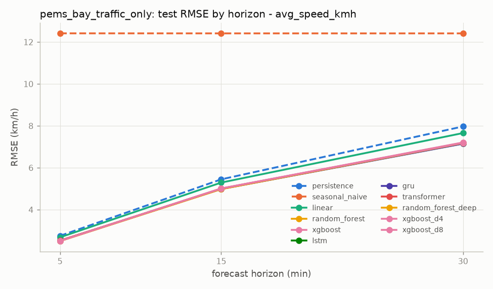
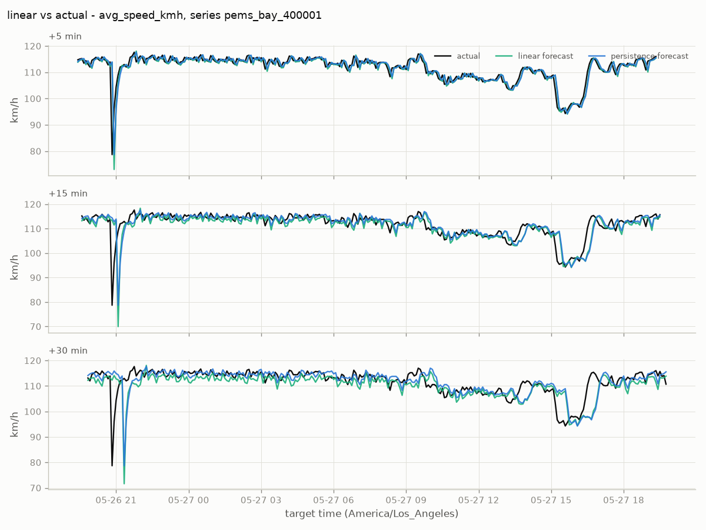
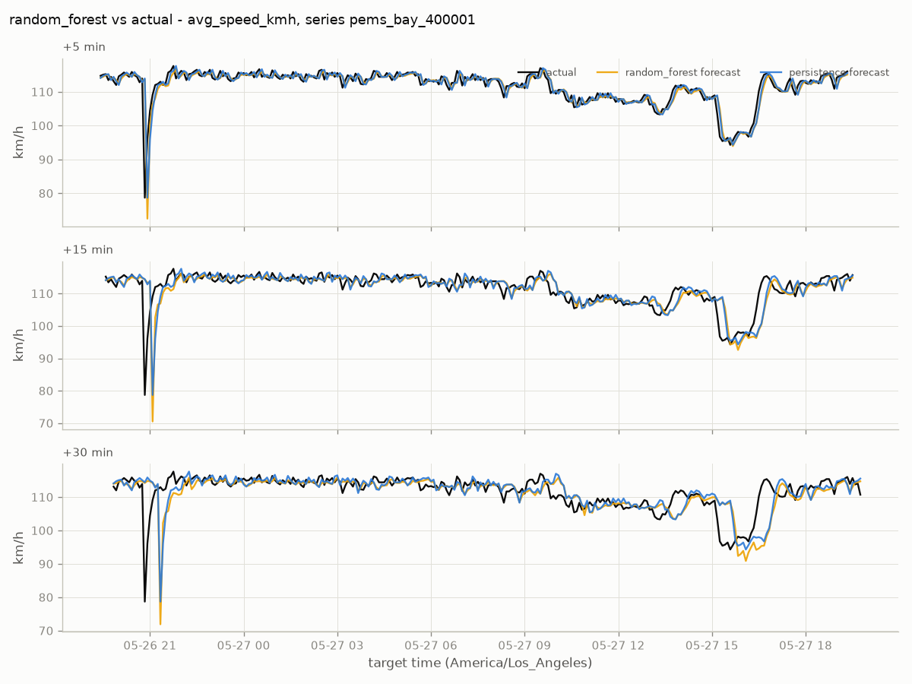
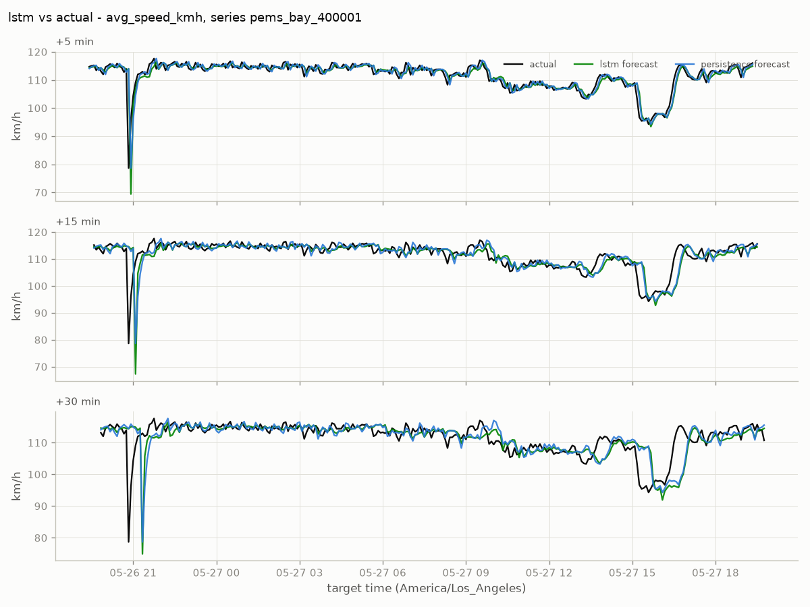
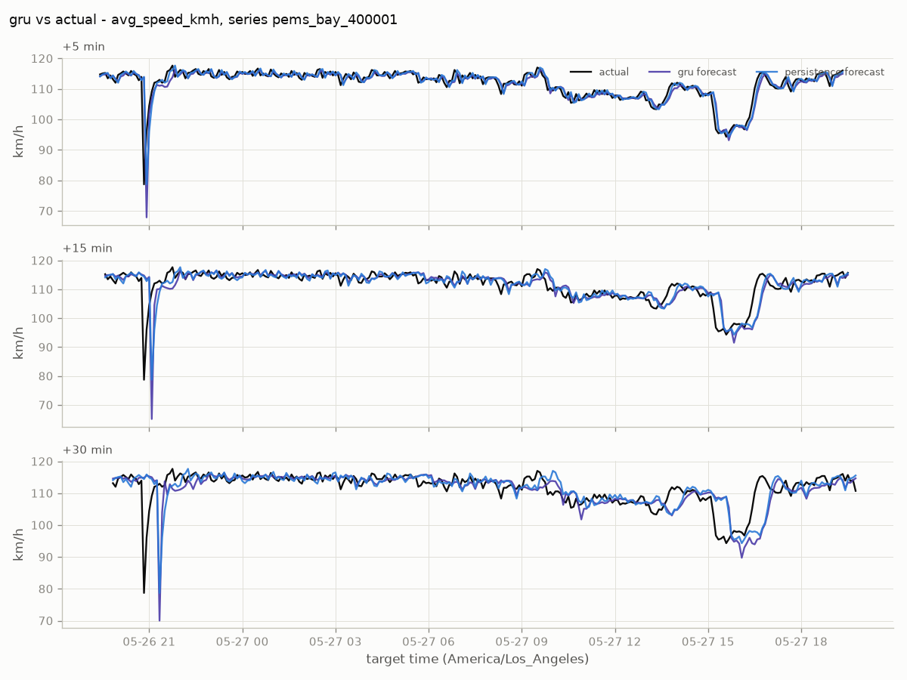
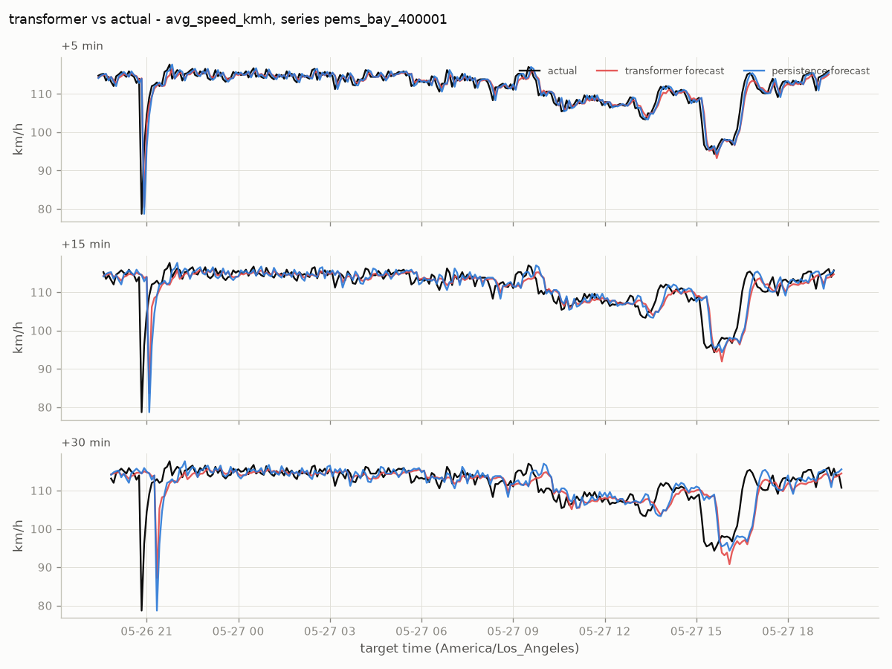
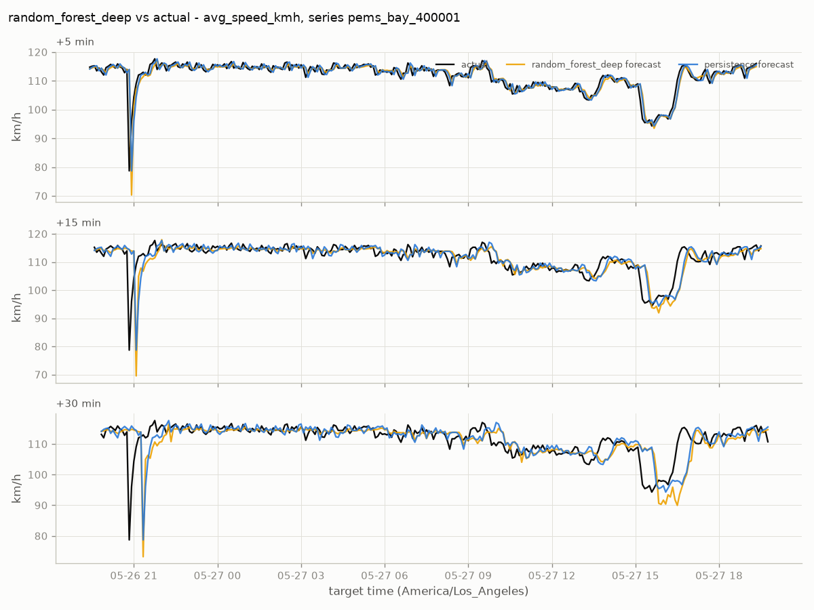
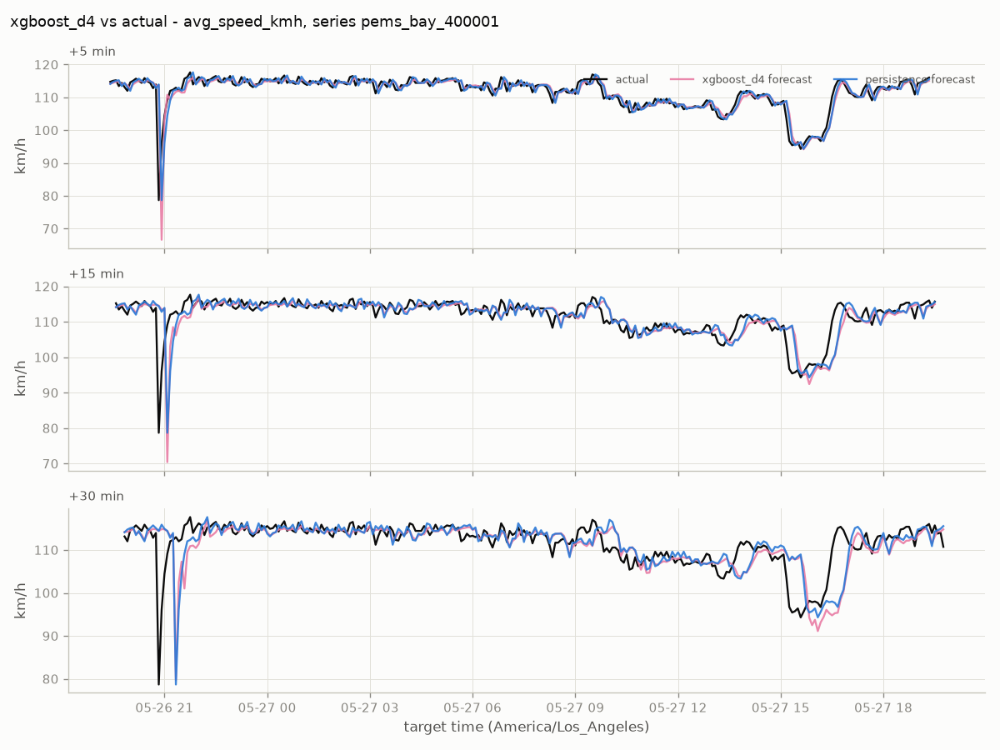
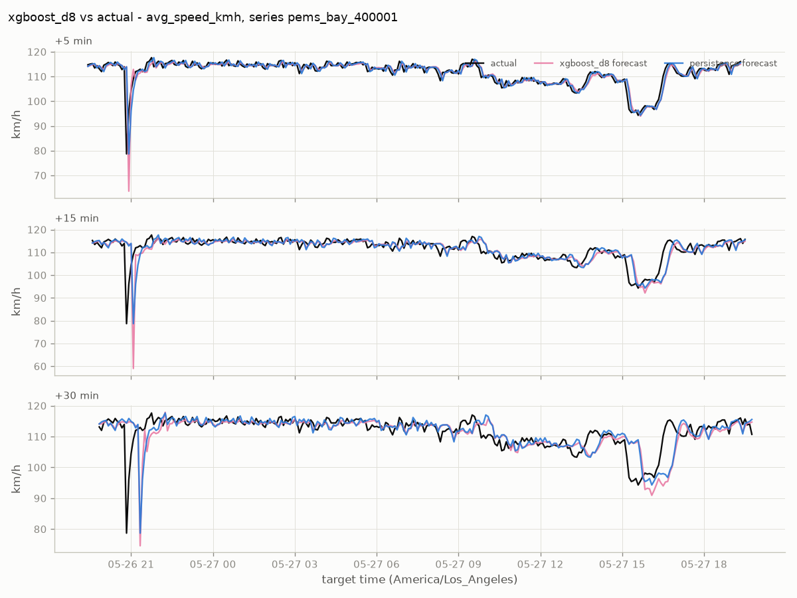

# Forecasting experiment `20260925-021348_pems_bay_traffic_only`

PEMS-BAY speed forecasting at +5/+15/+30 min (traffic only: past speeds of the sensor). Chronological split, fit-on-train scaling, identical windows for every model.

- **Dataset:** pems_bay (pems_bay), 11 series, resolution 300 s
- **Periods (chronological):** train 2017-01-01T08:00:00+00:00 -> 2017-05-08T00:05:00+00:00; val 2017-05-08T00:05:00+00:00 -> 2017-05-26T02:20:00+00:00; test 2017-05-26T02:20:00+00:00 -> 2017-07-01T07:00:00+00:00
- **Samples:** {'train': 401104, 'val': 57255, 'test': 114598} (identical test origins for every model)
- **Inputs (1):** avg_speed_kmh
- **Targets:** avg_speed_kmh; horizons [5, 15, 30] min
- **Model selection:** by validation RMSE on `avg_speed_kmh` -> **gru**

## avg_speed_kmh (km/h) - test, averaged over horizons

| model | MAE | RMSE | R2 | MAPE | skill |
|---|---|---|---|---|---|
| gru | 2.358 | 4.884 | 0.881 | 3.323 | 0.091 |
| random_forest_deep | 2.331 | 4.886 | 0.881 | 3.288 | 0.092 |
| lstm | 2.324 | 4.890 | 0.881 | 3.282 | 0.090 |
| random_forest | 2.340 | 4.893 | 0.881 | 3.286 | 0.090 |
| transformer | 2.348 | 4.901 | 0.880 | 3.294 | 0.088 |
| xgboost | 2.334 | 4.901 | 0.880 | 3.265 | 0.089 |
| xgboost_d8 | 2.332 | 4.901 | 0.880 | 3.258 | 0.089 |
| xgboost_d4 | 2.339 | 4.907 | 0.880 | 3.277 | 0.088 |
| linear | 2.542 | 5.209 | 0.865 | 3.466 | 0.031 |
| persistence | 2.468 | 5.389 | 0.855 | 3.270 | 0.000 |
| seasonal_naive | 5.463 | 12.4 | 0.333 | 7.864 | -1.784 |

## avg_speed_kmh by horizon (test)

**+5 min**

| model | MAE | RMSE | R2 | MAPE | skill |
|---|---|---|---|---|---|
| random_forest_deep | 1.393 | 2.499 | 0.973 | 1.720 | 0.092 |
| xgboost | 1.396 | 2.505 | 0.973 | 1.717 | 0.089 |
| xgboost_d4 | 1.398 | 2.506 | 0.973 | 1.720 | 0.089 |
| xgboost_d8 | 1.395 | 2.507 | 0.973 | 1.715 | 0.088 |
| random_forest | 1.405 | 2.510 | 0.973 | 1.730 | 0.087 |
| gru | 1.420 | 2.516 | 0.973 | 1.747 | 0.085 |
| lstm | 1.407 | 2.518 | 0.973 | 1.743 | 0.084 |
| transformer | 1.407 | 2.522 | 0.972 | 1.737 | 0.083 |
| linear | 1.525 | 2.678 | 0.969 | 1.854 | 0.026 |
| persistence | 1.501 | 2.750 | 0.967 | 1.834 | 0.000 |
| seasonal_naive | 5.464 | 12.4 | 0.333 | 7.865 | -3.514 |

**+15 min**

| model | MAE | RMSE | R2 | MAPE | skill |
|---|---|---|---|---|---|
| random_forest_deep | 2.346 | 4.980 | 0.893 | 3.235 | 0.085 |
| gru | 2.370 | 4.985 | 0.892 | 3.276 | 0.085 |
| random_forest | 2.359 | 4.988 | 0.892 | 3.238 | 0.084 |
| transformer | 2.365 | 4.995 | 0.892 | 3.239 | 0.083 |
| lstm | 2.343 | 4.995 | 0.892 | 3.235 | 0.083 |
| xgboost | 2.352 | 5.007 | 0.891 | 3.214 | 0.080 |
| xgboost_d4 | 2.357 | 5.007 | 0.891 | 3.224 | 0.080 |
| xgboost_d8 | 2.350 | 5.009 | 0.891 | 3.208 | 0.080 |
| linear | 2.573 | 5.292 | 0.879 | 3.433 | 0.028 |
| persistence | 2.498 | 5.446 | 0.872 | 3.276 | 0.000 |
| seasonal_naive | 5.463 | 12.4 | 0.333 | 7.863 | -1.279 |

**+30 min**

| model | MAE | RMSE | R2 | MAPE | skill |
|---|---|---|---|---|---|
| gru | 3.283 | 7.150 | 0.779 | 4.947 | 0.103 |
| lstm | 3.222 | 7.158 | 0.778 | 4.868 | 0.102 |
| random_forest_deep | 3.255 | 7.179 | 0.777 | 4.908 | 0.099 |
| random_forest | 3.258 | 7.181 | 0.777 | 4.889 | 0.099 |
| transformer | 3.272 | 7.187 | 0.776 | 4.906 | 0.098 |
| xgboost_d8 | 3.252 | 7.188 | 0.776 | 4.850 | 0.098 |
| xgboost | 3.255 | 7.191 | 0.776 | 4.863 | 0.098 |
| xgboost_d4 | 3.262 | 7.207 | 0.775 | 4.888 | 0.096 |
| linear | 3.527 | 7.656 | 0.746 | 5.110 | 0.039 |
| persistence | 3.405 | 7.970 | 0.725 | 4.699 | 0.000 |
| seasonal_naive | 5.462 | 12.4 | 0.333 | 7.862 | -0.557 |

## Seed variability of deep models (avg_speed_kmh, test RMSE, mean over horizons)

| model | mean | std | min | max | seeds |
|---|---|---|---|---|---|
| gru | 5.238 | 0.000 | 5.238 | 5.238 | 2 |
| lstm | 5.258 | 0.019 | 5.245 | 5.271 | 2 |
| transformer | 5.254 | 0.006 | 5.250 | 5.259 | 2 |

The tables above use, for each deep model, the seed with the best *validation* RMSE.

## Observations (derived automatically from the numbers above)

- +5 min: lowest test RMSE = **random_forest_deep** (2.499); persistence 2.750; linear 2.678
- +15 min: lowest test RMSE = **random_forest_deep** (4.980); persistence 5.446; linear 5.292
- +30 min: lowest test RMSE = **gru** (7.150); persistence 7.970; linear 7.656
- Best deep model gru vs best tree model random_forest_deep: RMSE 4.884 vs 4.886 (deep better by 0.0%).
- Best tree model random_forest_deep vs linear baseline: +6.2% RMSE reduction.
- Models beating persistence on average: linear, random_forest, xgboost, lstm, gru, transformer, random_forest_deep, xgboost_d4, xgboost_d8.
- Deep models whose mean-over-seeds RMSE (+1 std) is below the best tree model (random_forest_deep): none.

## Training cost

| model | family | fit (s) | predict (ms/sample) | epochs | parameters |
|---|---|---|---|---|---|
| persistence | baseline | 0.0 | 0.0001 | - | - |
| seasonal_naive | baseline | 0.0 | 0.0002 | - | - |
| linear | linear | 1.71 | 0.0009 | - | - |
| random_forest | tree | 9.63 | 0.0027 | - | - |
| xgboost | tree | 6.64 | 0.0015 | - | - |
| lstm | deep | 207.59 | 0.0026 | 33 | 50755 |
| gru | deep | 132.5 | 0.0015 | 28 | 38147 |
| transformer | deep | 230.02 | 0.0027 | 28 | 67715 |
| random_forest_deep | tree | 9.57 | 0.0036 | - | - |
| xgboost_d4 | tree | 9.77 | 0.0015 | - | - |
| xgboost_d8 | tree | 3.44 | 0.0009 | - | - |

## Figures

