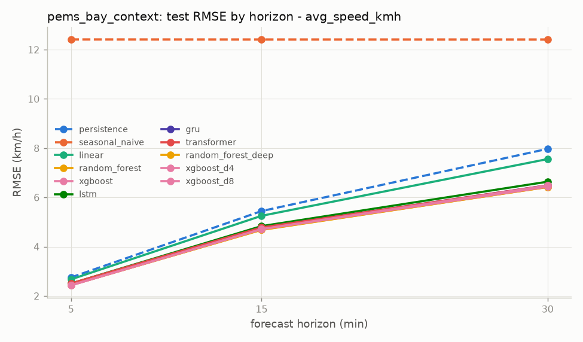
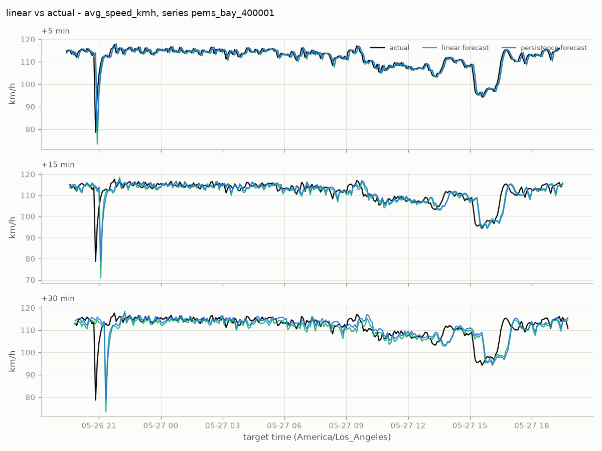
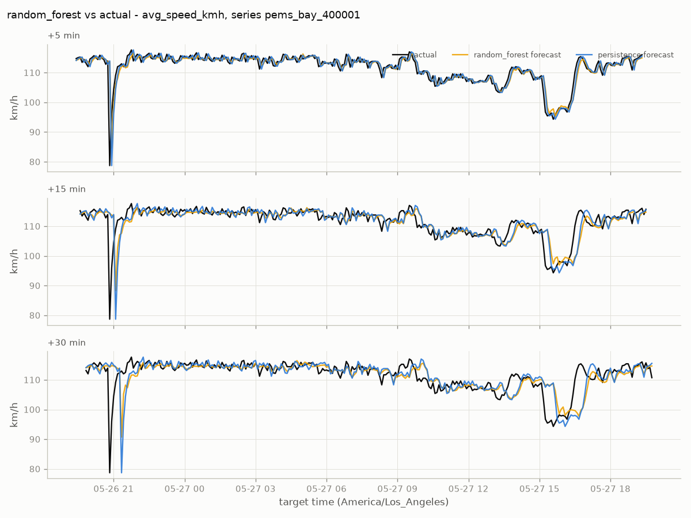
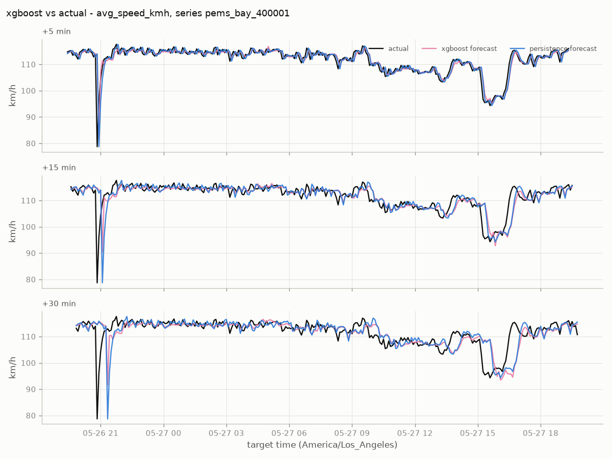
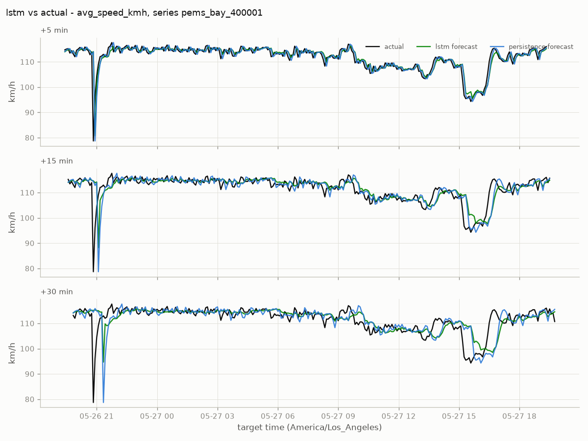
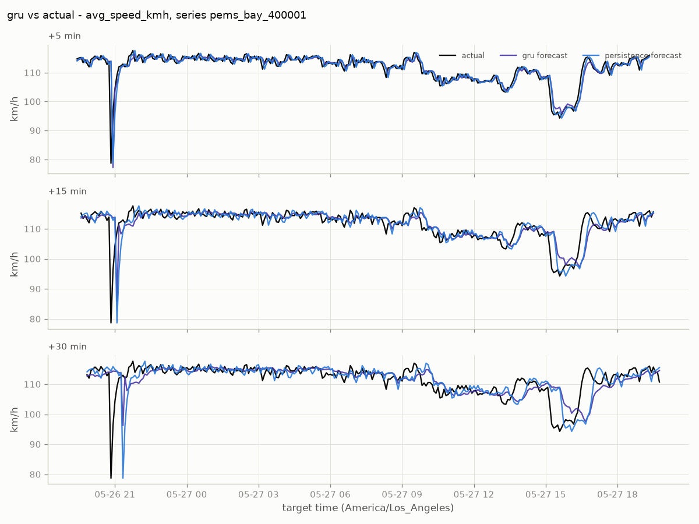
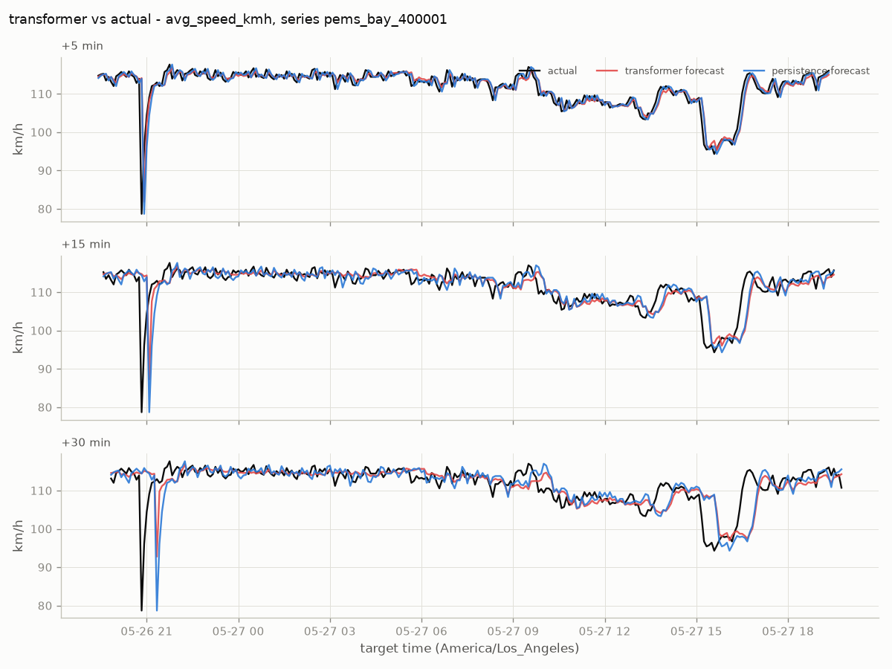
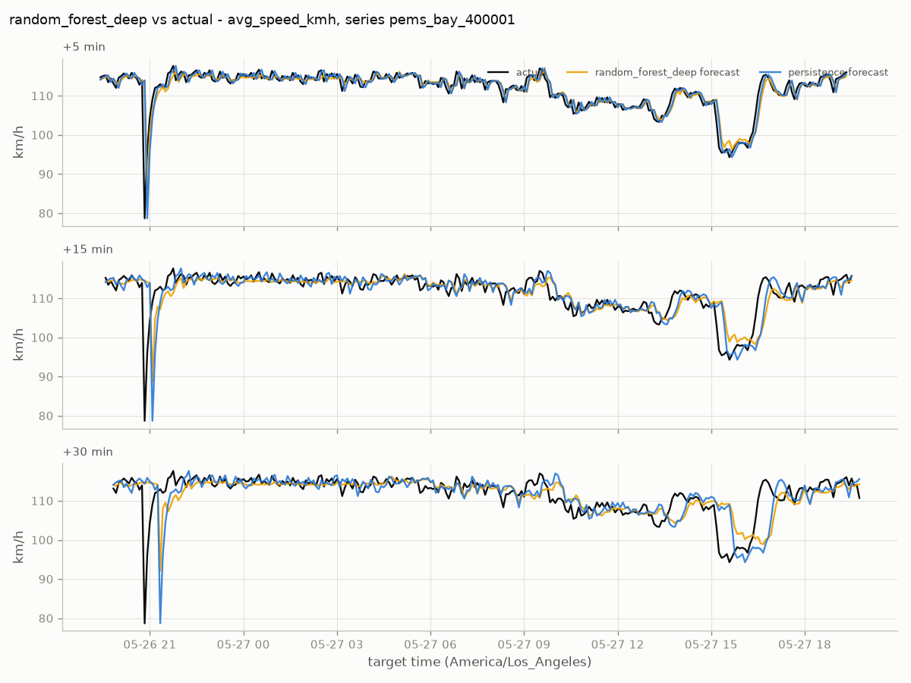
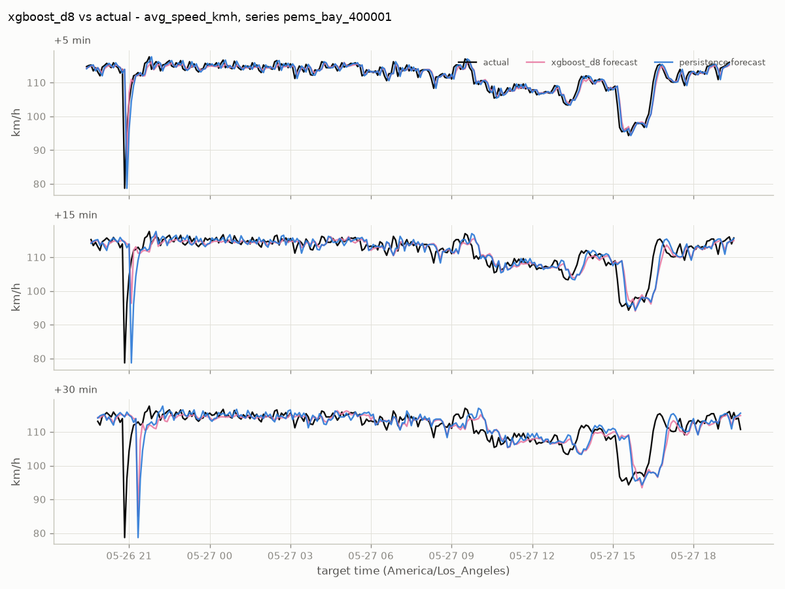

# Forecasting experiment `20260925-023203_pems_bay_context`

PEMS-BAY speed forecasting at +5/+15/+30 min (traffic + calendar + weather). Chronological split, fit-on-train scaling, identical windows for every model.

- **Dataset:** pems_bay (pems_bay), 11 series, resolution 300 s
- **Periods (chronological):** train 2017-01-01T08:00:00+00:00 -> 2017-05-08T00:05:00+00:00; val 2017-05-08T00:05:00+00:00 -> 2017-05-26T02:20:00+00:00; test 2017-05-26T02:20:00+00:00 -> 2017-07-01T07:00:00+00:00
- **Samples:** {'train': 401104, 'val': 57255, 'test': 114598} (identical test origins for every model)
- **Inputs (15):** avg_speed_kmh, hour_sin, hour_cos, dow_sin, dow_cos, is_weekend, is_holiday, is_rush_hour, temperature_c, humidity_pct, rain_mm, weather_clear, weather_cloudy, weather_drizzle, weather_rain
- **Targets:** avg_speed_kmh; horizons [5, 15, 30] min
- **Model selection:** by validation RMSE on `avg_speed_kmh` -> **random_forest_deep**

## avg_speed_kmh (km/h) - test, averaged over horizons

| model | MAE | RMSE | R2 | MAPE | skill |
|---|---|---|---|---|---|
| random_forest_deep | 2.215 | 4.514 | 0.900 | 3.081 | 0.149 |
| random_forest | 2.220 | 4.522 | 0.900 | 3.077 | 0.147 |
| xgboost_d8 | 2.218 | 4.524 | 0.900 | 3.112 | 0.148 |
| xgboost | 2.224 | 4.527 | 0.900 | 3.123 | 0.148 |
| xgboost_d4 | 2.241 | 4.546 | 0.899 | 3.141 | 0.144 |
| gru | 2.253 | 4.584 | 0.897 | 3.118 | 0.135 |
| transformer | 2.258 | 4.590 | 0.897 | 3.074 | 0.133 |
| lstm | 2.317 | 4.658 | 0.894 | 3.180 | 0.123 |
| linear | 2.548 | 5.160 | 0.867 | 3.487 | 0.039 |
| persistence | 2.468 | 5.389 | 0.855 | 3.270 | 0.000 |
| seasonal_naive | 5.463 | 12.4 | 0.333 | 7.864 | -1.784 |

## avg_speed_kmh by horizon (test)

**+5 min**

| model | MAE | RMSE | R2 | MAPE | skill |
|---|---|---|---|---|---|
| xgboost_d8 | 1.368 | 2.430 | 0.974 | 1.704 | 0.116 |
| xgboost | 1.371 | 2.431 | 0.974 | 1.711 | 0.116 |
| random_forest_deep | 1.373 | 2.438 | 0.974 | 1.707 | 0.114 |
| xgboost_d4 | 1.375 | 2.441 | 0.974 | 1.717 | 0.112 |
| random_forest | 1.385 | 2.454 | 0.974 | 1.718 | 0.108 |
| gru | 1.405 | 2.489 | 0.973 | 1.749 | 0.095 |
| lstm | 1.422 | 2.502 | 0.973 | 1.773 | 0.090 |
| transformer | 1.403 | 2.505 | 0.973 | 1.744 | 0.089 |
| linear | 1.525 | 2.671 | 0.969 | 1.859 | 0.029 |
| persistence | 1.501 | 2.750 | 0.967 | 1.834 | 0.000 |
| seasonal_naive | 5.464 | 12.4 | 0.333 | 7.865 | -3.514 |

**+15 min**

| model | MAE | RMSE | R2 | MAPE | skill |
|---|---|---|---|---|---|
| random_forest_deep | 2.261 | 4.682 | 0.905 | 3.113 | 0.140 |
| random_forest | 2.269 | 4.691 | 0.905 | 3.110 | 0.139 |
| xgboost | 2.269 | 4.703 | 0.904 | 3.144 | 0.136 |
| xgboost_d8 | 2.265 | 4.708 | 0.904 | 3.149 | 0.135 |
| xgboost_d4 | 2.283 | 4.716 | 0.904 | 3.153 | 0.134 |
| gru | 2.315 | 4.773 | 0.901 | 3.189 | 0.124 |
| transformer | 2.329 | 4.779 | 0.901 | 3.143 | 0.122 |
| lstm | 2.368 | 4.835 | 0.899 | 3.247 | 0.112 |
| linear | 2.581 | 5.253 | 0.880 | 3.456 | 0.035 |
| persistence | 2.498 | 5.446 | 0.872 | 3.276 | 0.000 |
| seasonal_naive | 5.463 | 12.4 | 0.333 | 7.863 | -1.279 |

**+30 min**

| model | MAE | RMSE | R2 | MAPE | skill |
|---|---|---|---|---|---|
| random_forest | 3.006 | 6.422 | 0.821 | 4.402 | 0.194 |
| random_forest_deep | 3.011 | 6.424 | 0.821 | 4.425 | 0.194 |
| xgboost_d8 | 3.021 | 6.434 | 0.821 | 4.482 | 0.193 |
| xgboost | 3.031 | 6.446 | 0.820 | 4.513 | 0.191 |
| xgboost_d4 | 3.063 | 6.482 | 0.818 | 4.554 | 0.187 |
| transformer | 3.043 | 6.486 | 0.818 | 4.335 | 0.186 |
| gru | 3.039 | 6.491 | 0.818 | 4.416 | 0.186 |
| lstm | 3.159 | 6.637 | 0.809 | 4.520 | 0.167 |
| linear | 3.537 | 7.556 | 0.753 | 5.147 | 0.052 |
| persistence | 3.405 | 7.970 | 0.725 | 4.699 | 0.000 |
| seasonal_naive | 5.462 | 12.4 | 0.333 | 7.862 | -0.557 |

## Seed variability of deep models (avg_speed_kmh, test RMSE, mean over horizons)

| model | mean | std | min | max | seeds |
|---|---|---|---|---|---|
| gru | 4.864 | 0.007 | 4.859 | 4.868 | 2 |
| lstm | 4.920 | 0.051 | 4.884 | 4.956 | 2 |
| transformer | 4.859 | 0.017 | 4.847 | 4.871 | 2 |

The tables above use, for each deep model, the seed with the best *validation* RMSE.

## Observations (derived automatically from the numbers above)

- +5 min: lowest test RMSE = **xgboost_d8** (2.430); persistence 2.750; linear 2.671
- +15 min: lowest test RMSE = **random_forest_deep** (4.682); persistence 5.446; linear 5.253
- +30 min: lowest test RMSE = **random_forest** (6.422); persistence 7.970; linear 7.556
- Best deep model gru vs best tree model random_forest_deep: RMSE 4.584 vs 4.514 (tree better by 1.5%).
- Best tree model random_forest_deep vs linear baseline: +12.5% RMSE reduction.
- Models beating persistence on average: linear, random_forest, xgboost, lstm, gru, transformer, random_forest_deep, xgboost_d4, xgboost_d8.
- Deep models whose mean-over-seeds RMSE (+1 std) is below the best tree model (random_forest_deep): none.

## Training cost

| model | family | fit (s) | predict (ms/sample) | epochs | parameters |
|---|---|---|---|---|---|
| persistence | baseline | 0.0 | 0.0001 | - | - |
| seasonal_naive | baseline | 0.0 | 0.0002 | - | - |
| linear | linear | 1.54 | 0.0012 | - | - |
| random_forest | tree | 12.74 | 0.0028 | - | - |
| xgboost | tree | 9.63 | 0.0017 | - | - |
| lstm | deep | 37.93 | 0.0017 | 13 | 54339 |
| gru | deep | 49.69 | 0.0015 | 18 | 40835 |
| transformer | deep | 103.07 | 0.003 | 16 | 68611 |
| random_forest_deep | tree | 17.58 | 0.0032 | - | - |
| xgboost_d4 | tree | 18.18 | 0.003 | - | - |
| xgboost_d8 | tree | 4.64 | 0.0012 | - | - |

## Figures

