# Forecasting experiment `20260925-023948_pems08_benchmark`

Real freeway data (12 detector stations, Jul-Aug 2016, San Bernardino CA) with real hourly weather (Open-Meteo archive). Question: do tree / deep models beat the linear and naive baselines at +5, +15, +30 minutes, and by how much?

- **Dataset:** pems08 (pems08), 13 series, resolution 300 s
- **Periods (chronological):** train 2016-07-01T07:00:00+00:00 -> 2016-08-07T11:45:00+00:00; val 2016-08-07T11:45:00+00:00 -> 2016-08-19T21:20:00+00:00; test 2016-08-19T21:20:00+00:00 -> 2016-09-01T07:00:00+00:00
- **Samples:** {'train': 138373, 'val': 46054, 'test': 46358} (identical test origins for every model)
- **Inputs (16):** flow_veh_h, avg_speed_kmh, occupancy_pct, hour_sin, hour_cos, dow_sin, dow_cos, is_weekend, is_holiday, is_rush_hour, temperature_c, humidity_pct, rain_mm, weather_clear, weather_cloudy, weather_drizzle
- **Targets:** flow_veh_h, avg_speed_kmh, occupancy_pct; horizons [5, 15, 30] min
- **Model selection:** by validation RMSE on `flow_veh_h` -> **xgboost_d8**

## flow_veh_h (veh/h) - test, averaged over horizons

| model | MAE | RMSE | R2 | MAPE | skill |
|---|---|---|---|---|---|
| xgboost_d8 | 148.1 | 240.9 | 0.979 | 6.851 | 0.237 |
| xgboost | 152.7 | 242.5 | 0.979 | 6.984 | 0.231 |
| xgboost_d4 | 163.7 | 251.0 | 0.977 | 7.438 | 0.206 |
| transformer | 170.8 | 252.0 | 0.977 | 8.025 | 0.202 |
| random_forest_deep | 160.2 | 252.7 | 0.977 | 7.364 | 0.199 |
| gru | 170.4 | 253.3 | 0.977 | 7.811 | 0.199 |
| lstm_L24 | 174.0 | 256.3 | 0.976 | 8.009 | 0.189 |
| lstm | 176.6 | 259.5 | 0.976 | 8.376 | 0.178 |
| random_forest | 172.1 | 263.0 | 0.975 | 7.823 | 0.167 |
| linear | 189.0 | 283.4 | 0.971 | 8.751 | 0.112 |
| persistence | 216.3 | 320.3 | 0.962 | 9.840 | 0.000 |
| seasonal_naive | 403.1 | 670.8 | 0.841 | 18.8 | -1.165 |

## avg_speed_kmh (km/h) - test, averaged over horizons

| model | MAE | RMSE | R2 | MAPE | skill |
|---|---|---|---|---|---|
| random_forest_deep | 1.584 | 3.452 | 0.898 | 1.894 | 0.117 |
| random_forest | 1.621 | 3.480 | 0.896 | 1.928 | 0.109 |
| xgboost_d8 | 1.563 | 3.485 | 0.895 | 1.903 | 0.112 |
| xgboost | 1.574 | 3.499 | 0.894 | 1.915 | 0.109 |
| xgboost_d4 | 1.595 | 3.499 | 0.894 | 1.932 | 0.108 |
| transformer | 1.717 | 3.638 | 0.885 | 2.041 | 0.074 |
| lstm_L24 | 1.800 | 3.717 | 0.881 | 2.129 | 0.050 |
| lstm | 1.798 | 3.730 | 0.879 | 2.132 | 0.052 |
| gru | 1.778 | 3.768 | 0.877 | 2.147 | 0.041 |
| linear | 1.774 | 3.799 | 0.874 | 2.083 | 0.036 |
| persistence | 1.740 | 3.954 | 0.863 | 2.008 | 0.000 |
| seasonal_naive | 3.765 | 8.728 | 0.412 | 4.616 | -1.583 |

## occupancy_pct (%) - test, averaged over horizons

| model | MAE | RMSE | R2 | MAPE | skill |
|---|---|---|---|---|---|
| random_forest_deep | 0.528 | 1.286 | 0.922 | 7.539 | 0.134 |
| random_forest | 0.545 | 1.293 | 0.921 | 7.885 | 0.129 |
| xgboost_d8 | 0.529 | 1.312 | 0.919 | 7.511 | 0.117 |
| xgboost | 0.536 | 1.317 | 0.918 | 7.634 | 0.114 |
| xgboost_d4 | 0.553 | 1.325 | 0.917 | 7.979 | 0.109 |
| lstm_L24 | 0.583 | 1.337 | 0.916 | 8.291 | 0.101 |
| transformer | 0.568 | 1.349 | 0.914 | 8.147 | 0.094 |
| lstm | 0.584 | 1.355 | 0.913 | 8.534 | 0.091 |
| gru | 0.579 | 1.365 | 0.912 | 8.204 | 0.082 |
| linear | 0.620 | 1.385 | 0.909 | 9.210 | 0.071 |
| persistence | 0.666 | 1.497 | 0.893 | 10.1 | 0.000 |
| seasonal_naive | 1.372 | 2.882 | 0.621 | 21.2 | -1.019 |

## flow_veh_h by horizon (test)

**+5 min**

| model | MAE | RMSE | R2 | MAPE | skill |
|---|---|---|---|---|---|
| xgboost_d8 | 133.7 | 210.6 | 0.984 | 6.197 | 0.167 |
| xgboost | 137.1 | 212.9 | 0.984 | 6.289 | 0.158 |
| xgboost_d4 | 142.7 | 217.1 | 0.983 | 6.506 | 0.141 |
| transformer | 147.8 | 218.4 | 0.983 | 6.914 | 0.136 |
| gru | 147.4 | 219.0 | 0.983 | 6.763 | 0.134 |
| random_forest_deep | 142.2 | 221.6 | 0.983 | 6.567 | 0.124 |
| lstm_L24 | 151.1 | 222.1 | 0.983 | 6.951 | 0.122 |
| lstm | 154.7 | 225.7 | 0.982 | 7.634 | 0.108 |
| linear | 153.2 | 228.0 | 0.982 | 7.026 | 0.098 |
| random_forest | 149.5 | 228.2 | 0.982 | 6.816 | 0.098 |
| persistence | 167.4 | 252.9 | 0.977 | 7.562 | 0.000 |
| seasonal_naive | 403.2 | 670.9 | 0.841 | 18.8 | -1.653 |

**+15 min**

| model | MAE | RMSE | R2 | MAPE | skill |
|---|---|---|---|---|---|
| xgboost_d8 | 148.5 | 241.4 | 0.979 | 6.874 | 0.226 |
| xgboost | 152.9 | 242.1 | 0.979 | 6.998 | 0.224 |
| xgboost_d4 | 164.8 | 252.0 | 0.978 | 7.476 | 0.193 |
| transformer | 171.7 | 253.2 | 0.977 | 8.083 | 0.189 |
| random_forest_deep | 161.7 | 254.3 | 0.977 | 7.408 | 0.185 |
| gru | 171.7 | 254.6 | 0.977 | 7.846 | 0.184 |
| lstm_L24 | 174.3 | 257.5 | 0.977 | 7.954 | 0.175 |
| lstm | 176.7 | 260.1 | 0.976 | 8.235 | 0.167 |
| random_forest | 173.8 | 264.8 | 0.975 | 7.881 | 0.152 |
| linear | 187.0 | 279.9 | 0.972 | 8.602 | 0.103 |
| persistence | 211.7 | 312.1 | 0.965 | 9.545 | 0.000 |
| seasonal_naive | 403.1 | 670.8 | 0.841 | 18.8 | -1.149 |

**+30 min**

| model | MAE | RMSE | R2 | MAPE | skill |
|---|---|---|---|---|---|
| xgboost_d8 | 162.2 | 270.5 | 0.974 | 7.482 | 0.317 |
| xgboost | 168.2 | 272.5 | 0.974 | 7.665 | 0.312 |
| random_forest_deep | 176.7 | 282.3 | 0.972 | 8.116 | 0.287 |
| xgboost_d4 | 183.4 | 283.9 | 0.971 | 8.331 | 0.283 |
| transformer | 192.9 | 284.5 | 0.971 | 9.079 | 0.282 |
| gru | 192.1 | 286.1 | 0.971 | 8.823 | 0.277 |
| lstm_L24 | 196.6 | 289.1 | 0.970 | 9.122 | 0.270 |
| lstm | 198.6 | 292.6 | 0.970 | 9.260 | 0.261 |
| random_forest | 192.9 | 296.0 | 0.969 | 8.771 | 0.253 |
| linear | 226.8 | 342.4 | 0.958 | 10.6 | 0.135 |
| persistence | 269.9 | 396.0 | 0.944 | 12.4 | 0.000 |
| seasonal_naive | 403.0 | 670.7 | 0.841 | 18.8 | -0.694 |

## Seed variability of deep models (flow_veh_h, test RMSE, mean over horizons)

| model | mean | std | min | max | seeds |
|---|---|---|---|---|---|
| gru | 256.9 | 2.120 | 254.7 | 259.0 | 3 |
| lstm | 262.8 | 1.636 | 260.9 | 263.9 | 3 |
| lstm_L24 | 259.2 | 1.482 | 257.7 | 260.7 | 3 |
| transformer | 255.8 | 3.040 | 253.5 | 259.2 | 3 |

The tables above use, for each deep model, the seed with the best *validation* RMSE.

## Observations (derived automatically from the numbers above)

- +5 min: lowest test RMSE = **xgboost_d8** (210.6); persistence 252.9; linear 228.0
- +15 min: lowest test RMSE = **xgboost_d8** (241.4); persistence 312.1; linear 279.9
- +30 min: lowest test RMSE = **xgboost_d8** (270.5); persistence 396.0; linear 342.4
- Best deep model transformer vs best tree model xgboost_d8: RMSE 252.0 vs 240.9 (tree better by 4.6%).
- Best tree model xgboost_d8 vs linear baseline: +15.0% RMSE reduction.
- Models beating persistence on average: linear, random_forest, xgboost, lstm, gru, transformer, lstm_L24, random_forest_deep, xgboost_d4, xgboost_d8.
- Deep models whose mean-over-seeds RMSE (+1 std) is below the best tree model (xgboost_d8): none.

## Training cost

| model | family | fit (s) | predict (ms/sample) | epochs | parameters |
|---|---|---|---|---|---|
| persistence | baseline | 0.0 | 0.0002 | - | - |
| seasonal_naive | baseline | 0.0 | 0.0004 | - | - |
| linear | linear | 1.53 | 0.0016 | - | - |
| random_forest | tree | 10.91 | 0.005 | - | - |
| xgboost | tree | 27.38 | 0.0104 | - | - |
| lstm | deep | 18.57 | 0.0016 | 13 | 54985 |
| gru | deep | 23.07 | 0.0016 | 19 | 41417 |
| transformer | deep | 68.4 | 0.0059 | 20 | 69449 |
| lstm_L24 | deep | 17.28 | 0.0022 | 15 | 54985 |
| random_forest_deep | tree | 14.19 | 0.0059 | - | - |
| xgboost_d4 | tree | 13.37 | 0.0056 | - | - |
| xgboost_d8 | tree | 28.06 | 0.0092 | - | - |

## Figures

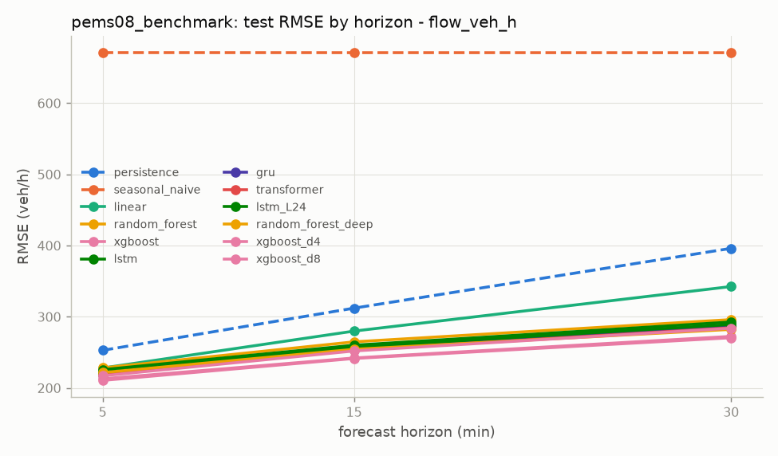
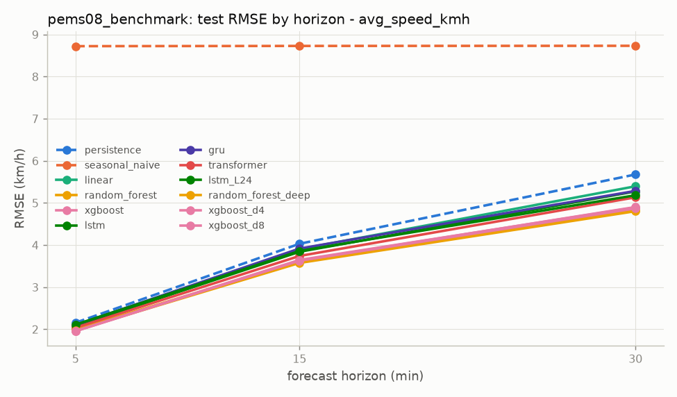
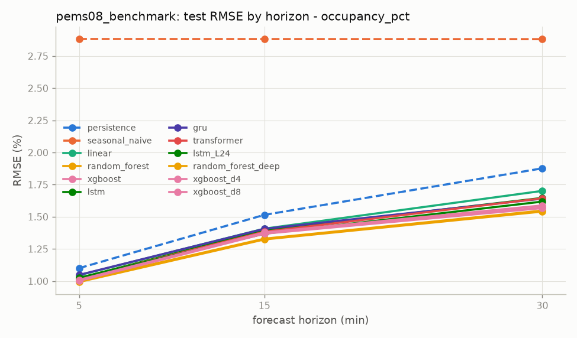
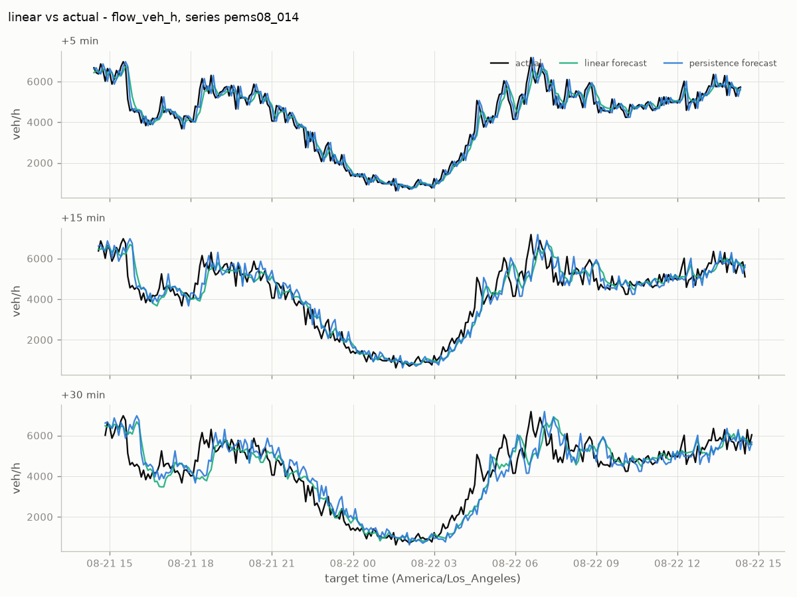
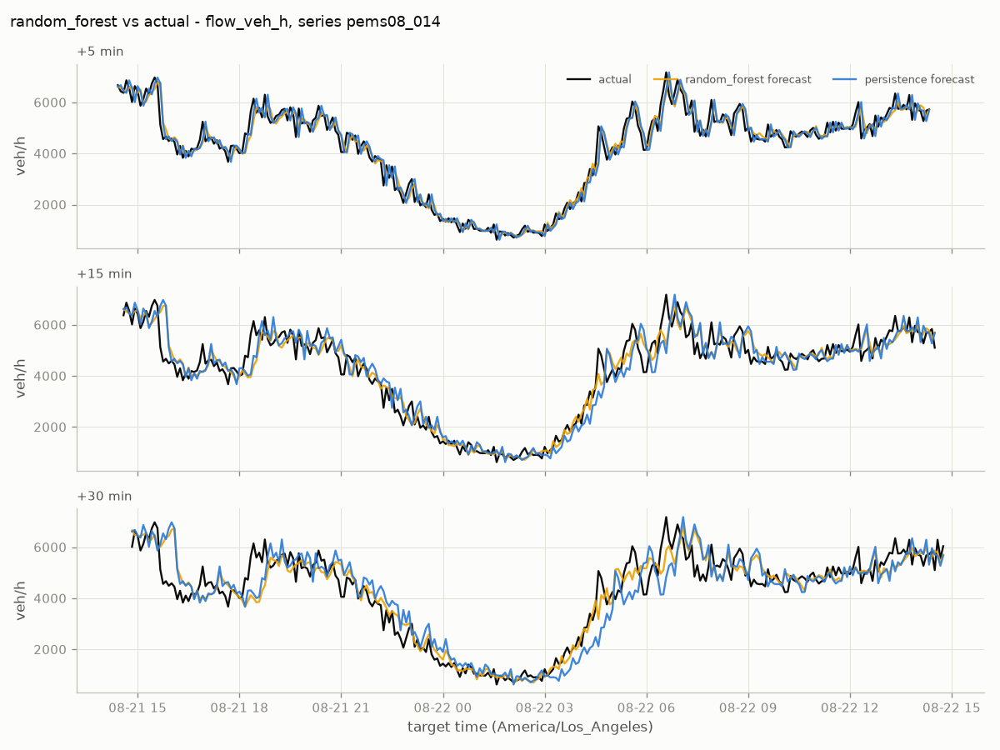
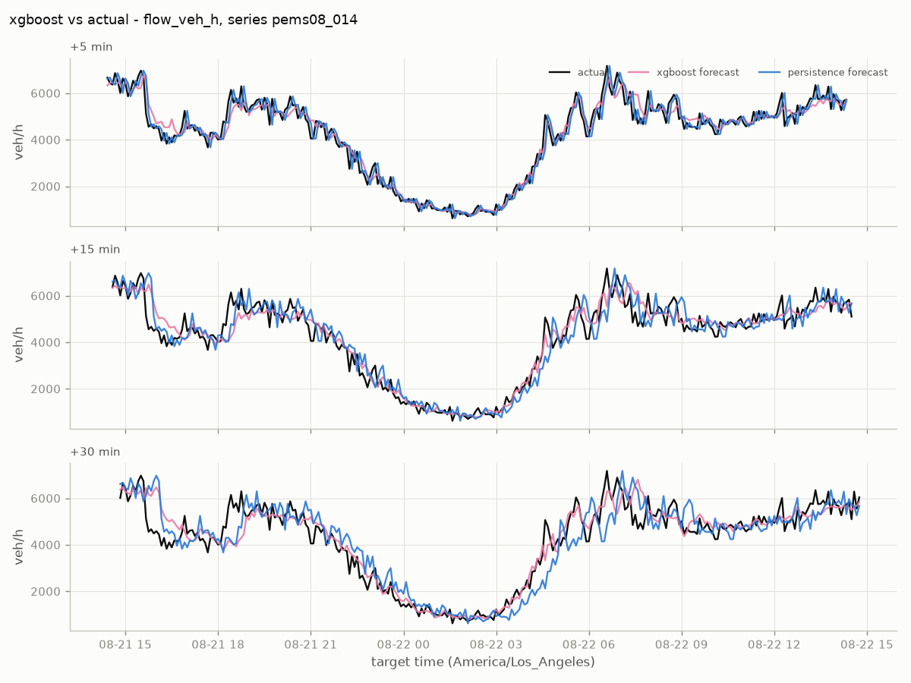
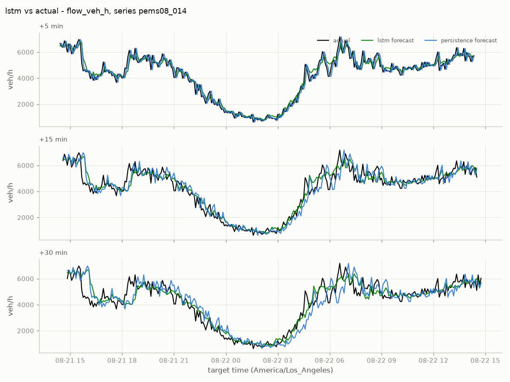
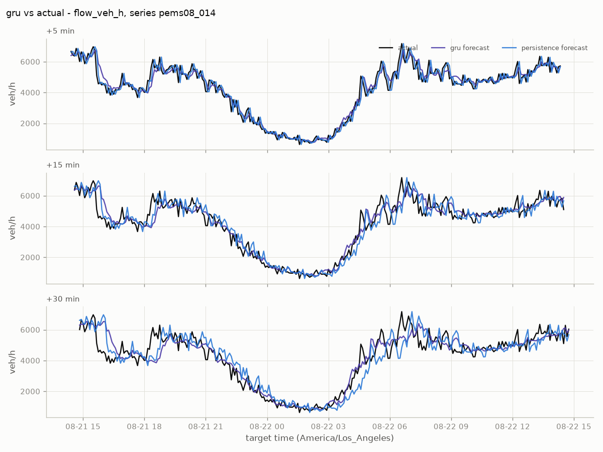
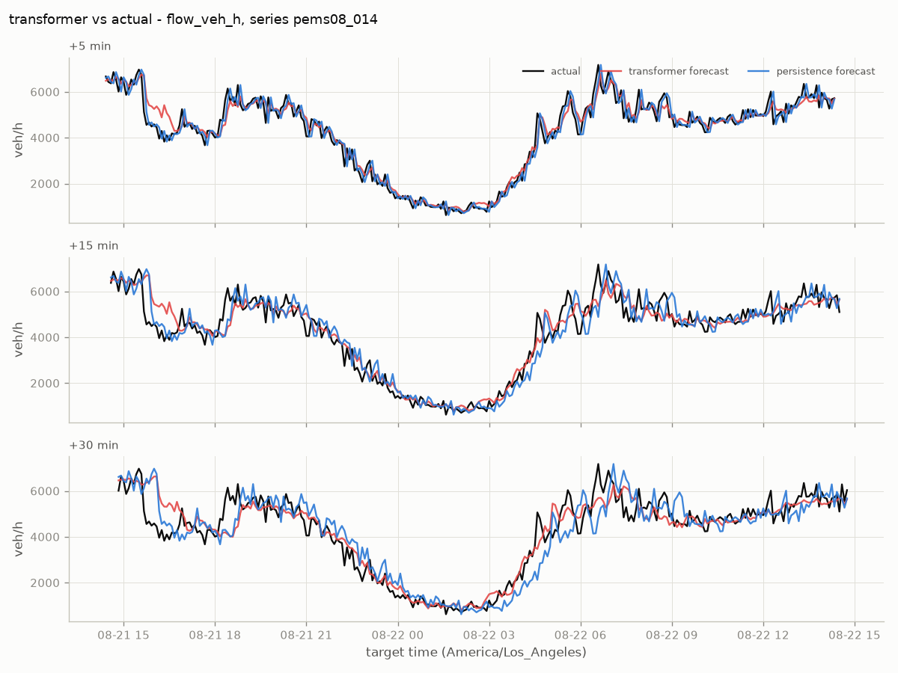
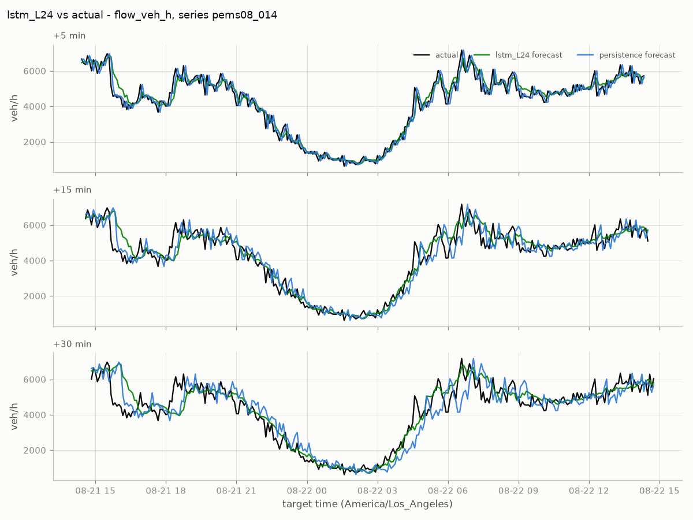
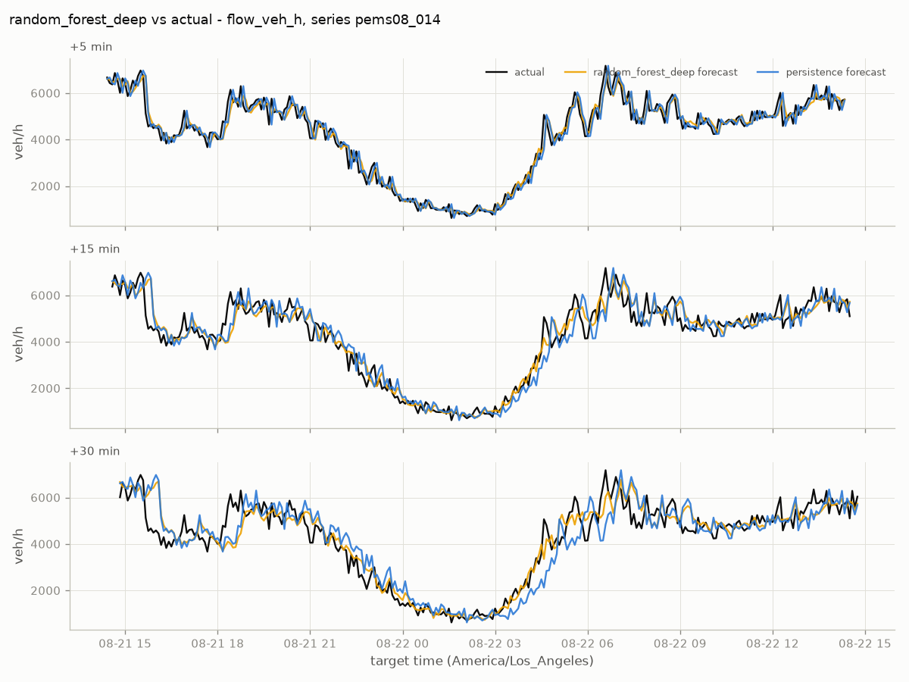
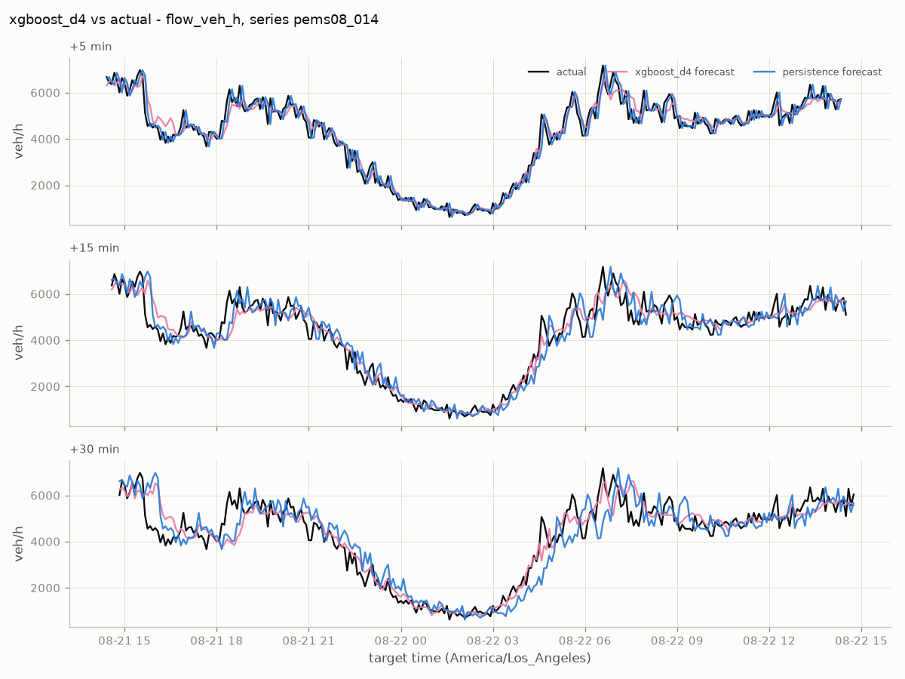
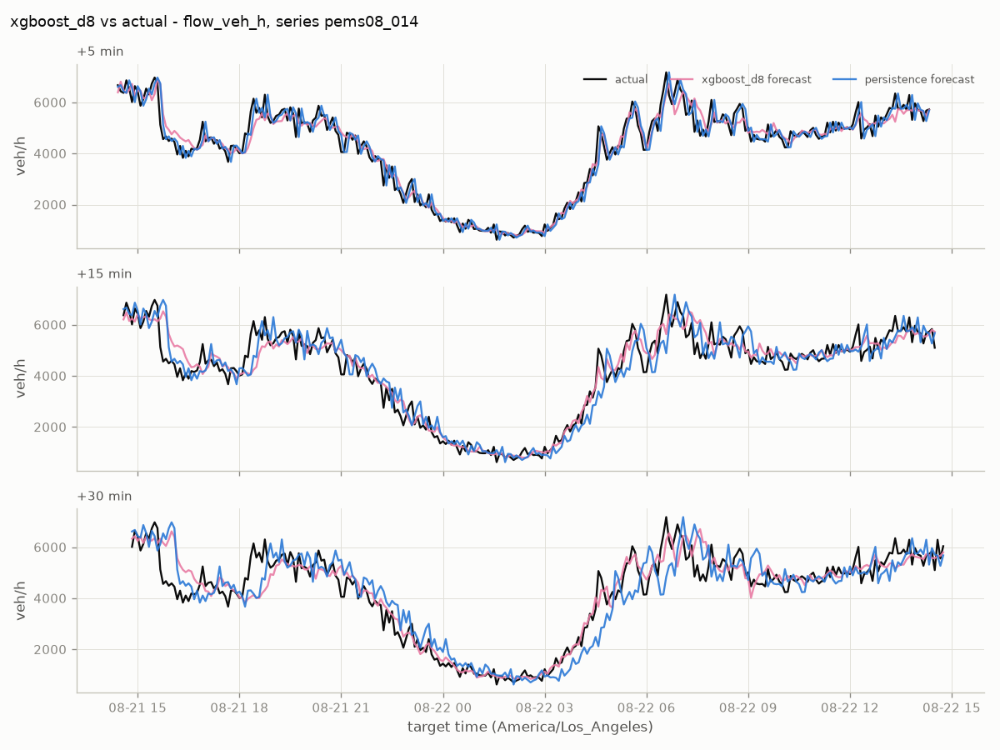
