# Forecasting experiment `20260925-024730_synthetic_junction`

6 weeks x 4 approaches of synthetic 1-minute traffic states (demand profiles, signal capacity, point queues, incidents, sensor gaps) driven by REAL Bengaluru weather (Open-Meteo, Jun-Jul 2025). Synthetic: validates the pipeline and gives the service a schema-compatible model; it is not evidence about real traffic (see forecasting_pems08.yaml for that).

- **Dataset:** synthetic (synthetic), 4 series, resolution 60 s
- **Periods (chronological):** train 2025-06-01T18:30:00+00:00 -> 2025-06-26T23:18:00+00:00; val 2025-06-26T23:18:00+00:00 -> 2025-07-05T08:54:00+00:00; test 2025-07-05T08:54:00+00:00 -> 2025-07-13T18:30:00+00:00
- **Samples:** {'train': 71809, 'val': 47994, 'test': 48185} (identical test origins for every model)
- **Inputs (23):** avg_speed_kmh, density_ratio, occupancy_pct, queue_length_m, flow_veh_h, vehicle_count, inflow, outflow, stopped_vehicles, hour_sin, hour_cos, dow_sin, dow_cos, is_weekend, is_holiday, is_rush_hour, temperature_c, humidity_pct, rain_mm, weather_clear, weather_cloudy, weather_drizzle, weather_rain
- **Targets:** avg_speed_kmh, density_ratio, occupancy_pct, queue_length_m, flow_veh_h; horizons [5, 15, 30] min
- **Model selection:** by validation RMSE on `avg_speed_kmh` -> **xgboost_d8**

## avg_speed_kmh (km/h) - test, averaged over horizons

| model | MAE | RMSE | R2 | MAPE | skill |
|---|---|---|---|---|---|
| xgboost_d8 | 1.869 | 3.352 | 0.844 | 13.1 | 0.327 |
| xgboost | 1.887 | 3.354 | 0.844 | 13.3 | 0.327 |
| xgboost_d4 | 1.900 | 3.367 | 0.843 | 13.6 | 0.325 |
| random_forest_deep | 1.972 | 3.438 | 0.836 | 13.8 | 0.311 |
| random_forest | 1.982 | 3.449 | 0.835 | 13.9 | 0.309 |
| gru | 1.909 | 3.457 | 0.834 | 13.9 | 0.309 |
| lstm | 2.166 | 3.638 | 0.816 | 14.7 | 0.273 |
| transformer | 2.037 | 3.680 | 0.811 | 15.8 | 0.268 |
| linear | 2.194 | 3.822 | 0.794 | 16.9 | 0.244 |
| persistence | 2.612 | 5.100 | 0.628 | 16.3 | 0.000 |
| seasonal_naive | 3.509 | 7.334 | 0.256 | 29.1 | -0.487 |

## density_ratio (ratio) - test, averaged over horizons

| model | MAE | RMSE | R2 | MAPE | skill |
|---|---|---|---|---|---|
| xgboost | 0.031 | 0.081 | 0.817 | - | 0.305 |
| random_forest | 0.031 | 0.081 | 0.817 | - | 0.306 |
| xgboost_d4 | 0.031 | 0.081 | 0.817 | - | 0.304 |
| random_forest_deep | 0.031 | 0.081 | 0.817 | - | 0.304 |
| xgboost_d8 | 0.030 | 0.081 | 0.816 | - | 0.301 |
| gru | 0.031 | 0.084 | 0.800 | - | 0.279 |
| lstm | 0.033 | 0.085 | 0.798 | - | 0.275 |
| transformer | 0.034 | 0.089 | 0.776 | - | 0.244 |
| linear | 0.041 | 0.094 | 0.750 | - | 0.209 |
| persistence | 0.041 | 0.121 | 0.570 | - | 0.000 |
| seasonal_naive | 0.063 | 0.185 | 0.048 | - | -0.644 |

## occupancy_pct (%) - test, averaged over horizons

| model | MAE | RMSE | R2 | MAPE | skill |
|---|---|---|---|---|---|
| xgboost | 2.444 | 6.510 | 0.813 | 47.9 | 0.301 |
| xgboost_d8 | 2.403 | 6.521 | 0.812 | 46.6 | 0.299 |
| xgboost_d4 | 2.484 | 6.523 | 0.812 | 49.2 | 0.300 |
| random_forest | 2.440 | 6.533 | 0.811 | 46.7 | 0.299 |
| random_forest_deep | 2.451 | 6.543 | 0.811 | 47.1 | 0.297 |
| gru | 2.474 | 6.832 | 0.793 | 46.9 | 0.271 |
| lstm | 2.613 | 6.841 | 0.792 | 52.7 | 0.269 |
| transformer | 2.661 | 7.175 | 0.770 | 54.4 | 0.239 |
| linear | 3.239 | 7.526 | 0.745 | 70.0 | 0.206 |
| persistence | 3.276 | 9.680 | 0.564 | 69.3 | 0.000 |
| seasonal_naive | 5.040 | 14.9 | 0.030 | 110.2 | -0.651 |

## queue_length_m (m) - test, averaged over horizons

| model | MAE | RMSE | R2 | MAPE | skill |
|---|---|---|---|---|---|
| random_forest | 1.392 | 5.651 | 0.749 | 52.3 | 0.288 |
| xgboost | 1.364 | 5.662 | 0.748 | 52.4 | 0.285 |
| random_forest_deep | 1.407 | 5.667 | 0.747 | 52.3 | 0.285 |
| xgboost_d4 | 1.417 | 5.673 | 0.747 | 52.6 | 0.284 |
| xgboost_d8 | 1.345 | 5.687 | 0.746 | 52.5 | 0.282 |
| gru | 1.553 | 5.900 | 0.725 | 53.3 | 0.259 |
| lstm | 1.740 | 5.901 | 0.725 | 53.4 | 0.259 |
| transformer | 1.733 | 6.132 | 0.701 | 55.3 | 0.234 |
| linear | 2.460 | 6.422 | 0.670 | 54.1 | 0.201 |
| persistence | 1.542 | 8.204 | 0.446 | 61.6 | 0.000 |
| seasonal_naive | 2.858 | 12.2 | -0.151 | 95.7 | -0.583 |

## flow_veh_h (veh/h) - test, averaged over horizons

| model | MAE | RMSE | R2 | MAPE | skill |
|---|---|---|---|---|---|
| xgboost | 116.8 | 163.8 | 0.819 | 43.1 | 0.309 |
| xgboost_d4 | 116.8 | 163.8 | 0.819 | 43.2 | 0.309 |
| xgboost_d8 | 116.5 | 163.8 | 0.819 | 42.8 | 0.309 |
| gru | 118.9 | 165.9 | 0.814 | 45.3 | 0.301 |
| lstm | 121.6 | 169.9 | 0.805 | 46.1 | 0.284 |
| random_forest_deep | 120.5 | 171.0 | 0.802 | 44.0 | 0.279 |
| transformer | 121.2 | 171.1 | 0.802 | 44.5 | 0.279 |
| random_forest | 121.1 | 172.7 | 0.798 | 43.8 | 0.272 |
| linear | 123.9 | 173.6 | 0.796 | 47.9 | 0.270 |
| persistence | 165.7 | 238.3 | 0.614 | 63.1 | 0.000 |
| seasonal_naive | 194.6 | 300.3 | 0.391 | 71.4 | -0.269 |

## avg_speed_kmh by horizon (test)

**+5 min**

| model | MAE | RMSE | R2 | MAPE | skill |
|---|---|---|---|---|---|
| xgboost_d4 | 1.747 | 3.067 | 0.870 | 11.5 | 0.238 |
| xgboost | 1.748 | 3.067 | 0.870 | 11.3 | 0.237 |
| xgboost_d8 | 1.746 | 3.085 | 0.868 | 11.4 | 0.233 |
| gru | 1.763 | 3.096 | 0.867 | 12.0 | 0.230 |
| random_forest_deep | 1.822 | 3.144 | 0.863 | 11.6 | 0.218 |
| random_forest | 1.832 | 3.152 | 0.863 | 11.7 | 0.216 |
| transformer | 1.845 | 3.184 | 0.860 | 13.0 | 0.208 |
| linear | 1.825 | 3.202 | 0.858 | 12.7 | 0.204 |
| lstm | 1.969 | 3.266 | 0.852 | 12.6 | 0.188 |
| persistence | 2.196 | 4.022 | 0.776 | 11.8 | 0.000 |
| seasonal_naive | 3.509 | 7.334 | 0.256 | 29.2 | -0.824 |

**+15 min**

| model | MAE | RMSE | R2 | MAPE | skill |
|---|---|---|---|---|---|
| xgboost_d8 | 1.893 | 3.406 | 0.840 | 13.5 | 0.314 |
| xgboost | 1.909 | 3.418 | 0.838 | 13.8 | 0.312 |
| xgboost_d4 | 1.925 | 3.442 | 0.836 | 14.1 | 0.307 |
| random_forest_deep | 1.990 | 3.494 | 0.831 | 14.2 | 0.296 |
| gru | 1.916 | 3.502 | 0.830 | 14.2 | 0.295 |
| random_forest | 1.999 | 3.504 | 0.830 | 14.3 | 0.294 |
| lstm | 2.190 | 3.666 | 0.814 | 15.0 | 0.262 |
| transformer | 2.049 | 3.709 | 0.810 | 16.1 | 0.253 |
| linear | 2.160 | 3.801 | 0.800 | 16.9 | 0.235 |
| persistence | 2.538 | 4.965 | 0.659 | 15.2 | 0.000 |
| seasonal_naive | 3.508 | 7.334 | 0.256 | 29.1 | -0.477 |

**+30 min**

| model | MAE | RMSE | R2 | MAPE | skill |
|---|---|---|---|---|---|
| xgboost_d8 | 1.969 | 3.565 | 0.824 | 14.4 | 0.435 |
| xgboost | 2.005 | 3.578 | 0.823 | 14.9 | 0.433 |
| xgboost_d4 | 2.027 | 3.593 | 0.821 | 15.2 | 0.431 |
| random_forest_deep | 2.103 | 3.678 | 0.813 | 15.7 | 0.417 |
| random_forest | 2.114 | 3.690 | 0.812 | 15.7 | 0.416 |
| gru | 2.047 | 3.772 | 0.803 | 15.5 | 0.402 |
| lstm | 2.340 | 3.980 | 0.781 | 16.6 | 0.369 |
| transformer | 2.217 | 4.147 | 0.762 | 18.4 | 0.343 |
| linear | 2.596 | 4.463 | 0.725 | 21.0 | 0.293 |
| persistence | 3.103 | 6.313 | 0.449 | 21.8 | 0.000 |
| seasonal_naive | 3.508 | 7.334 | 0.256 | 29.1 | -0.162 |

## Seed variability of deep models (avg_speed_kmh, test RMSE, mean over horizons)

| model | mean | std | min | max | seeds |
|---|---|---|---|---|---|
| gru | 3.491 | 0.041 | 3.468 | 3.538 | 3 |
| lstm | 3.677 | 0.140 | 3.553 | 3.830 | 3 |
| transformer | 3.665 | 0.051 | 3.607 | 3.701 | 3 |

The tables above use, for each deep model, the seed with the best *validation* RMSE.

## Observations (derived automatically from the numbers above)

- +5 min: lowest test RMSE = **xgboost_d4** (3.067); persistence 4.022; linear 3.202
- +15 min: lowest test RMSE = **xgboost_d8** (3.406); persistence 4.965; linear 3.801
- +30 min: lowest test RMSE = **xgboost_d8** (3.565); persistence 6.313; linear 4.463
- Best deep model gru vs best tree model xgboost_d8: RMSE 3.457 vs 3.352 (tree better by 3.1%).
- Best tree model xgboost_d8 vs linear baseline: +12.3% RMSE reduction.
- Models beating persistence on average: linear, random_forest, xgboost, lstm, gru, transformer, random_forest_deep, xgboost_d4, xgboost_d8.
- Deep models whose mean-over-seeds RMSE (+1 std) is below the best tree model (xgboost_d8): none.

## Training cost

| model | family | fit (s) | predict (ms/sample) | epochs | parameters |
|---|---|---|---|---|---|
| persistence | baseline | 0.0 | 0.0002 | - | - |
| seasonal_naive | baseline | 0.0 | 0.0004 | - | - |
| linear | linear | 1.32 | 0.0057 | - | - |
| random_forest | tree | 15.23 | 0.0074 | - | - |
| xgboost | tree | 9.71 | 0.0037 | - | - |
| lstm | deep | 7.94 | 0.0025 | 12 | 57167 |
| gru | deep | 15.0 | 0.0024 | 23 | 43151 |
| transformer | deep | 20.74 | 0.0047 | 14 | 70671 |
| random_forest_deep | tree | 22.15 | 0.0101 | - | - |
| xgboost_d4 | tree | 13.28 | 0.0052 | - | - |
| xgboost_d8 | tree | 14.46 | 0.0035 | - | - |

## Figures

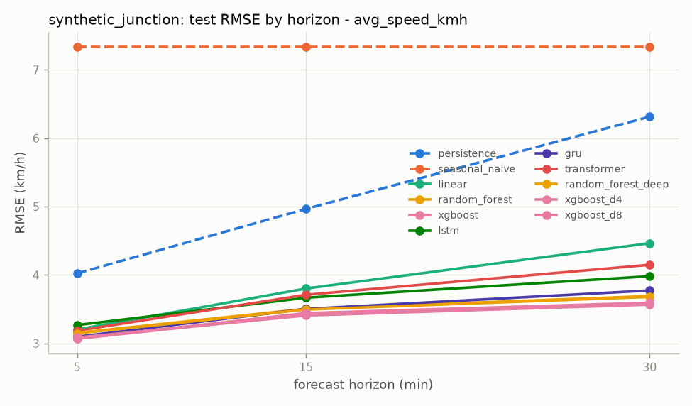
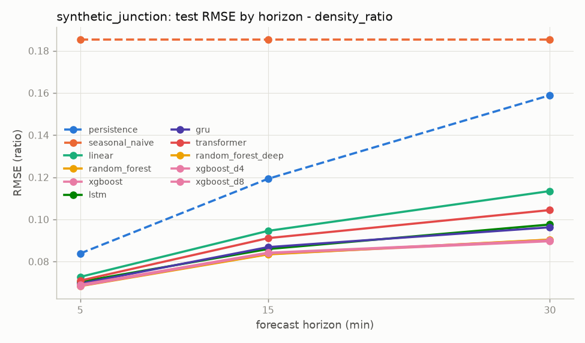
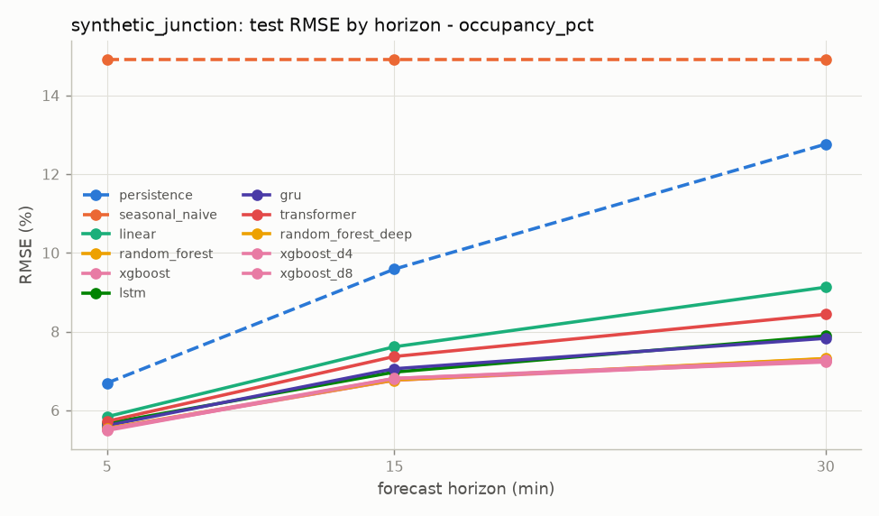
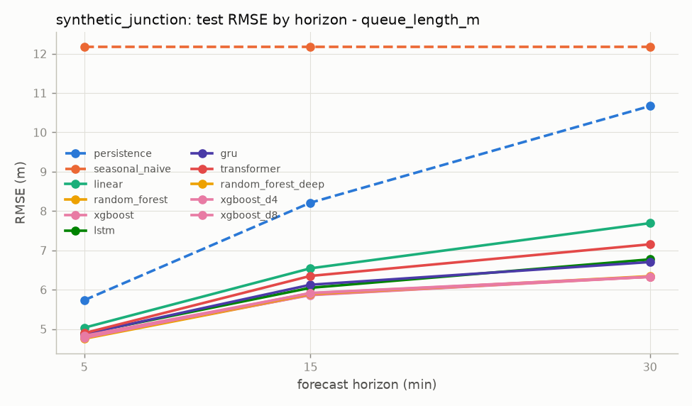
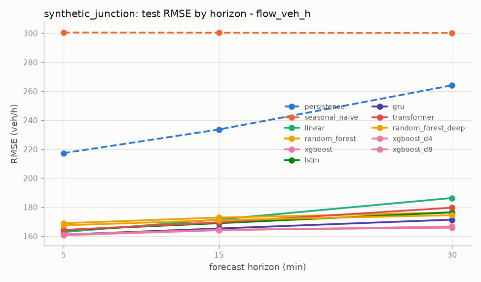
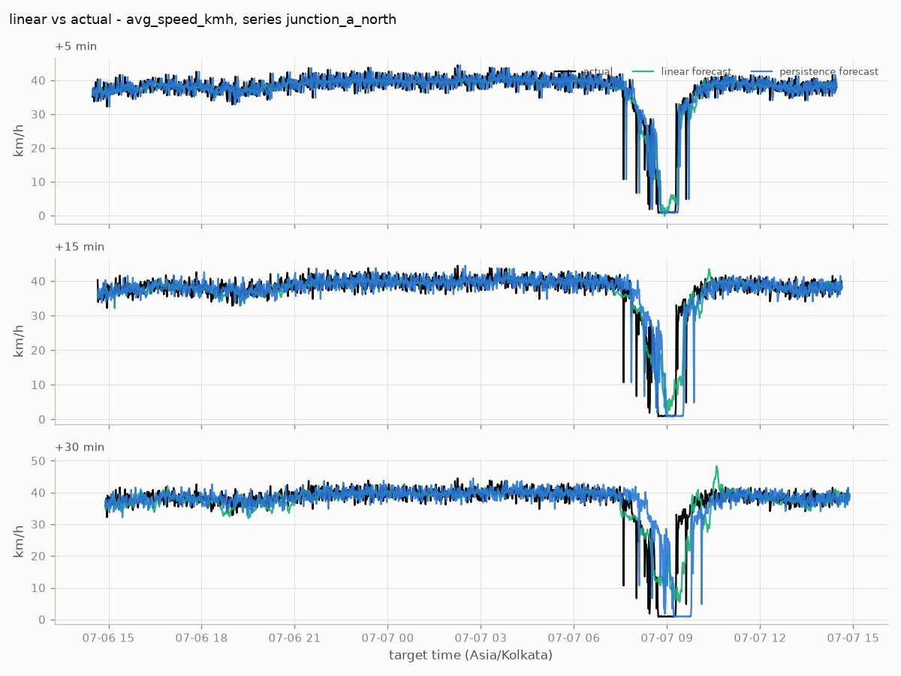
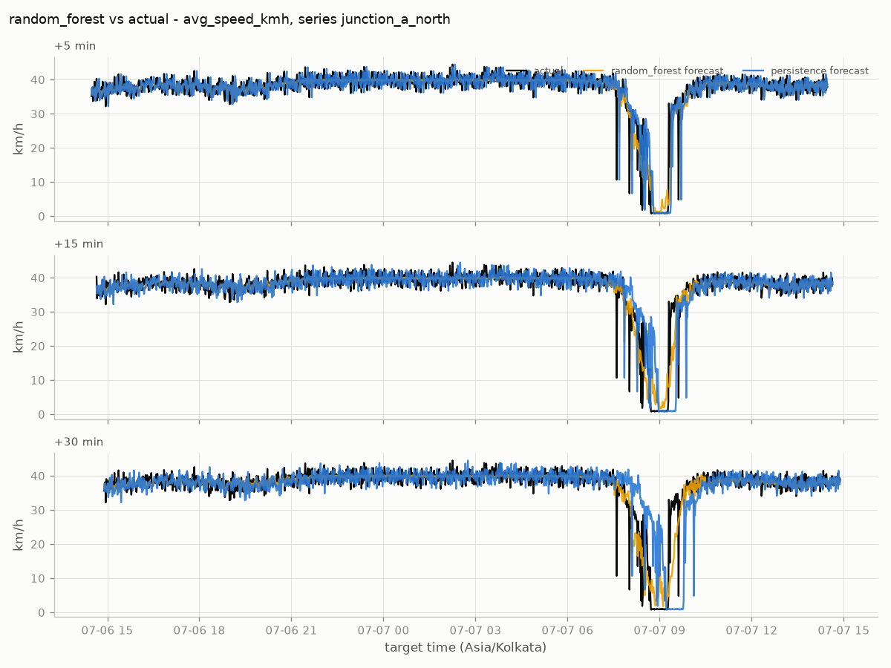
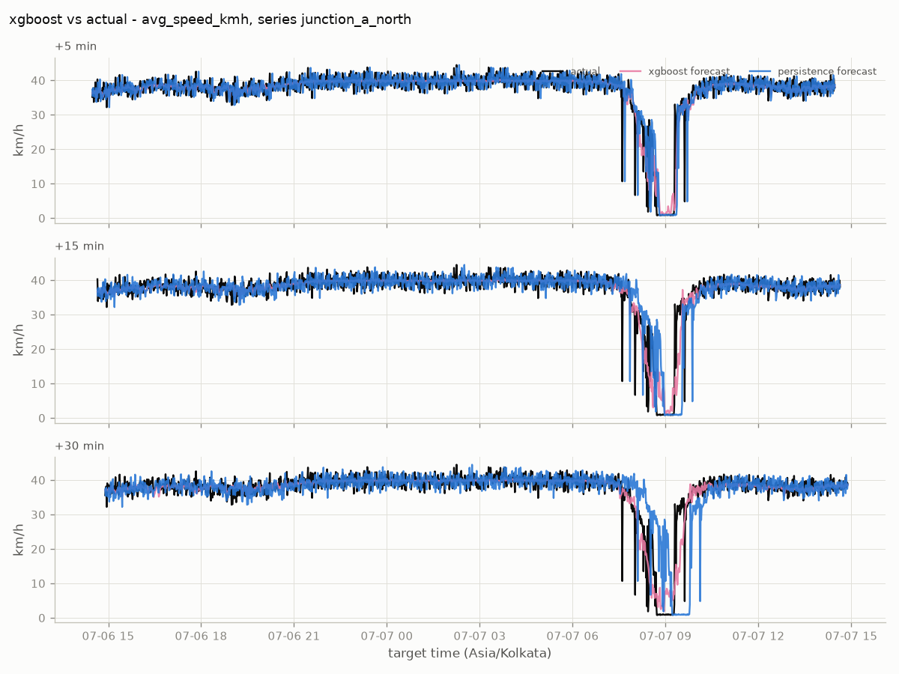
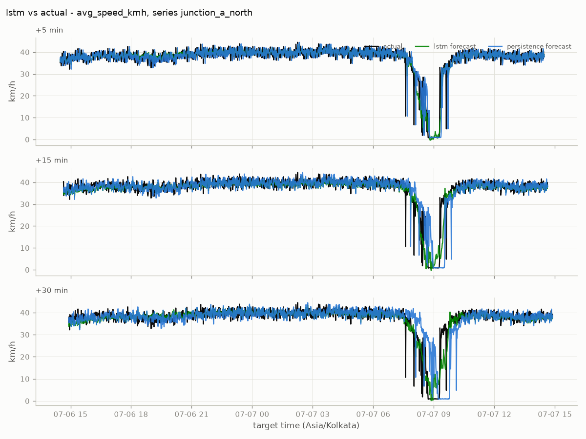
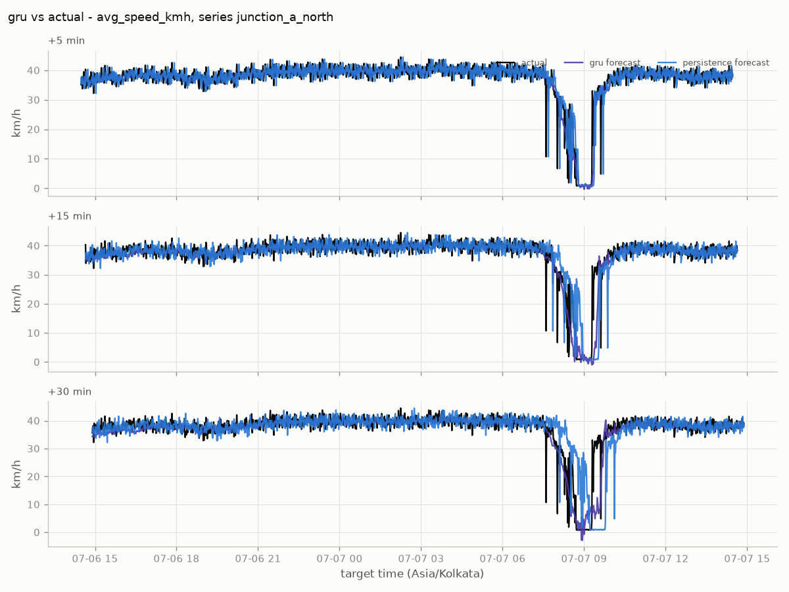
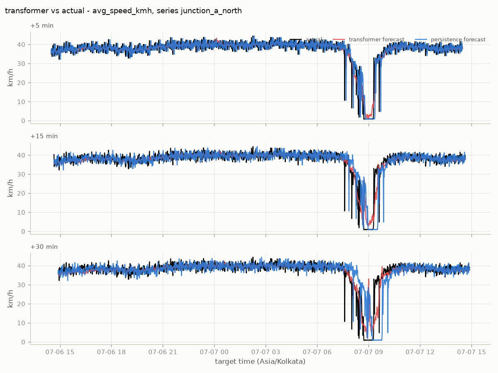
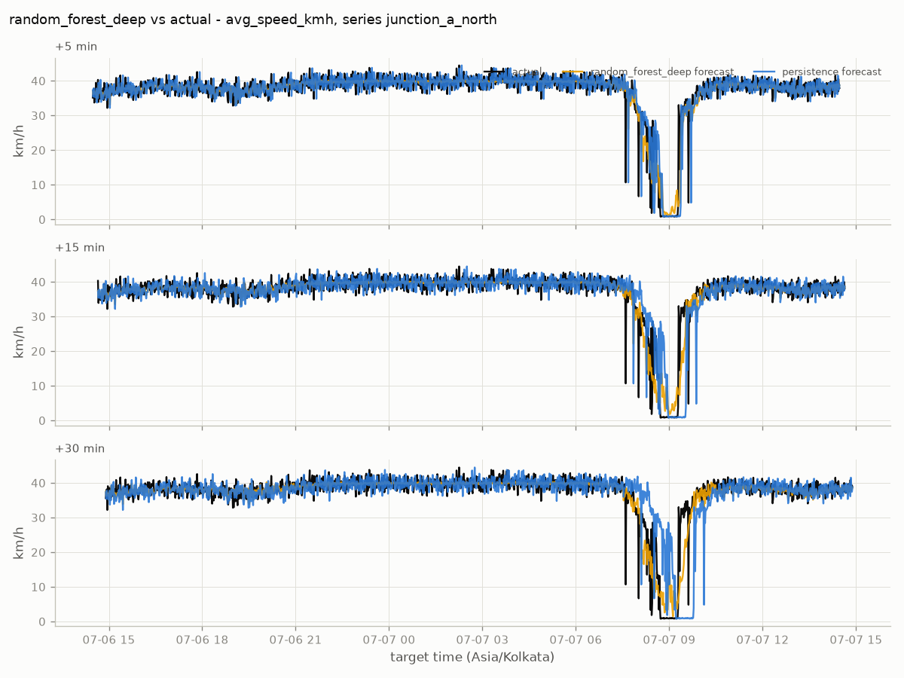
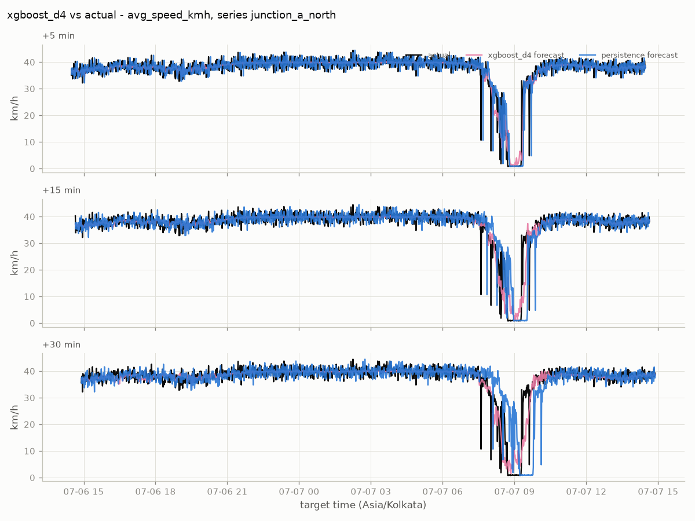
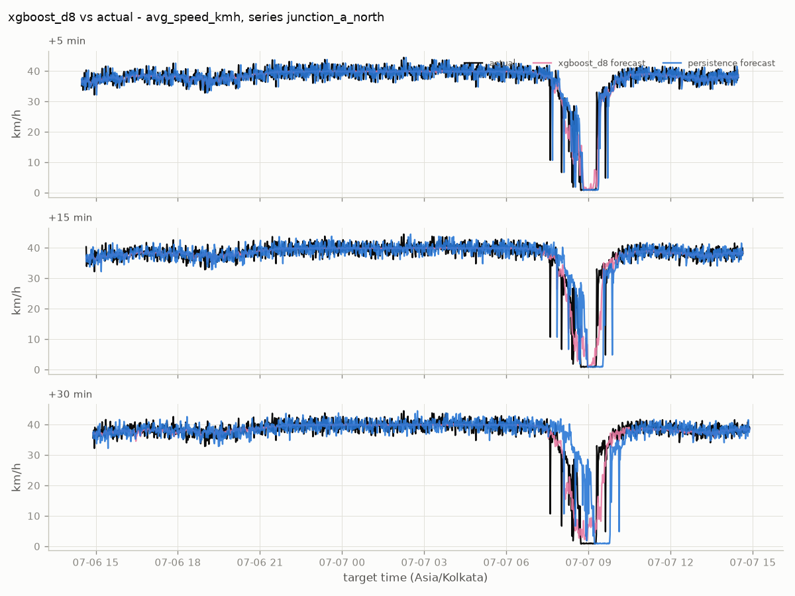
