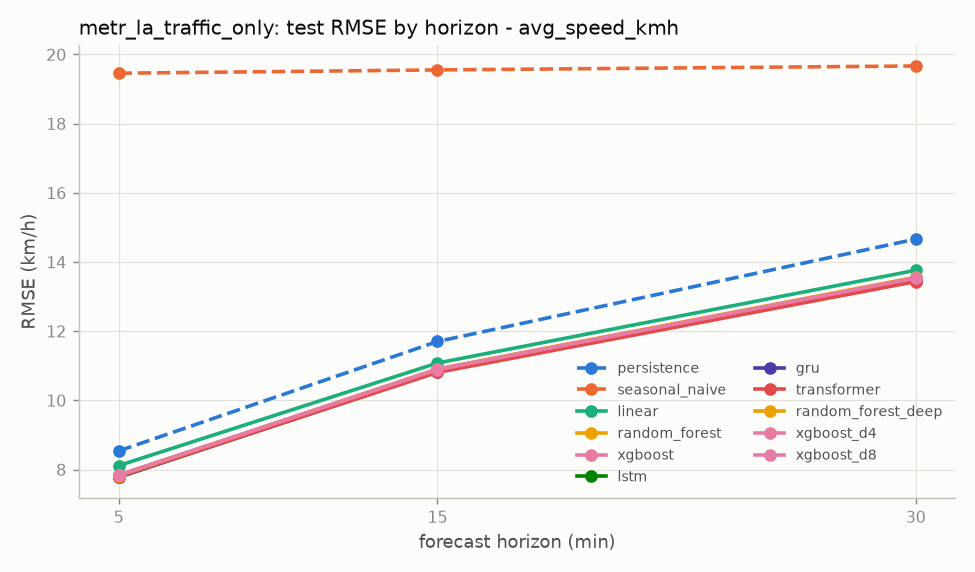
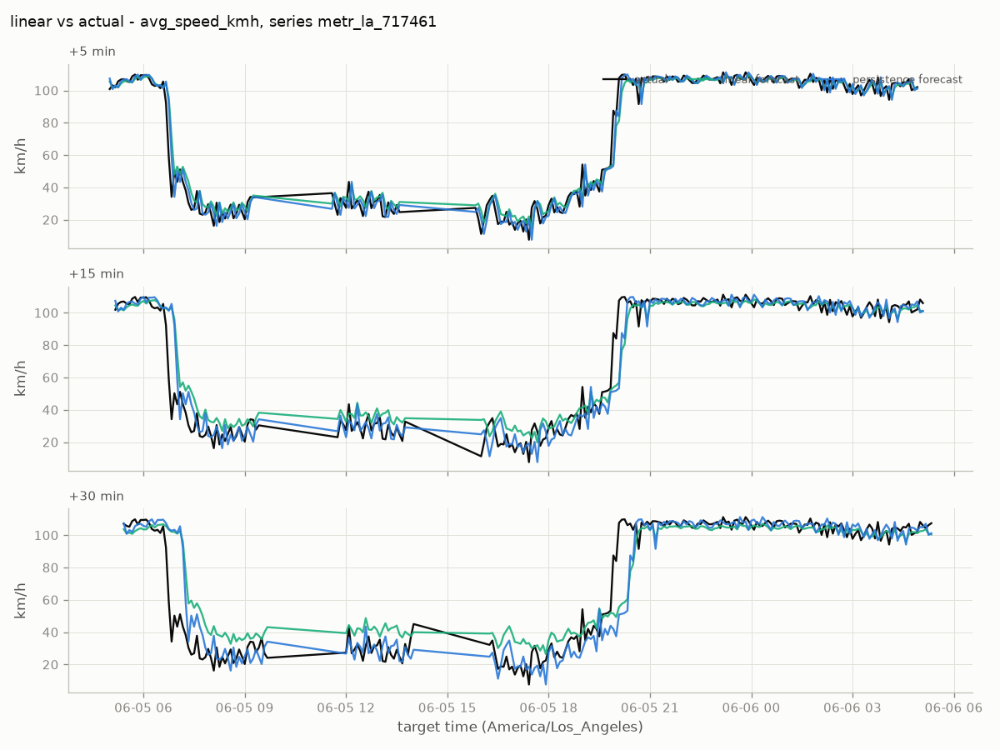
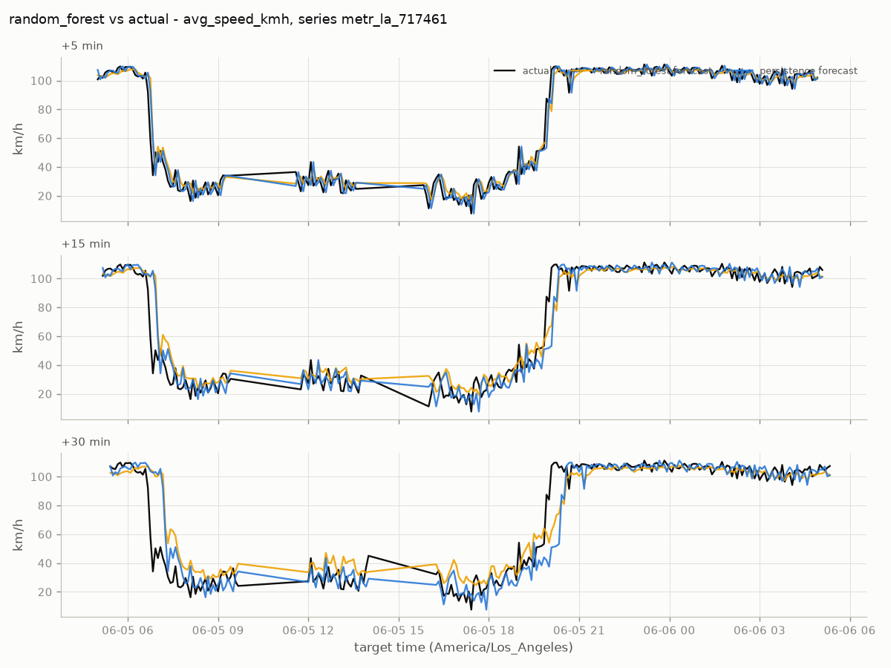
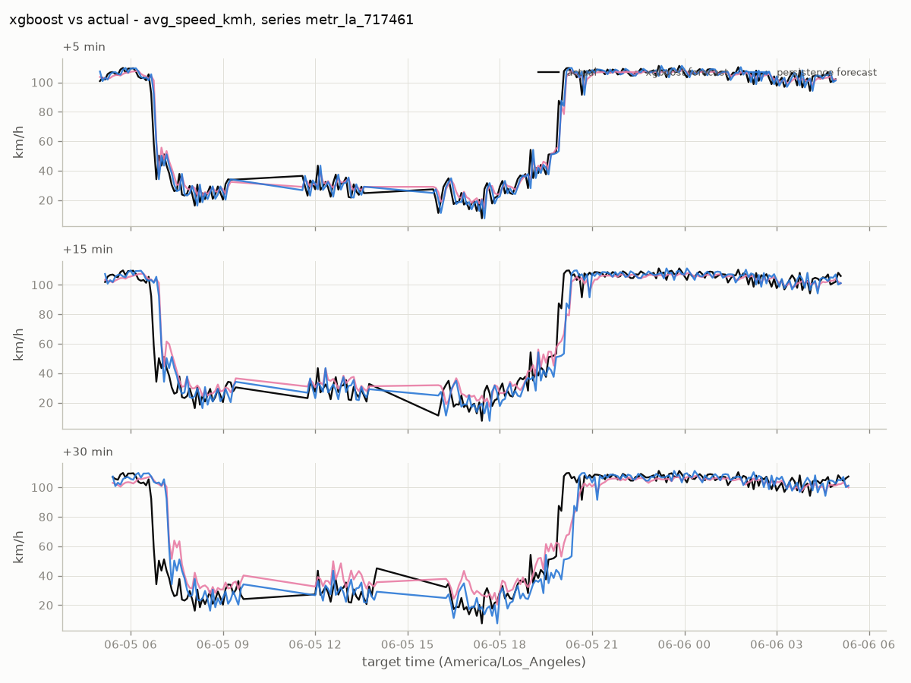
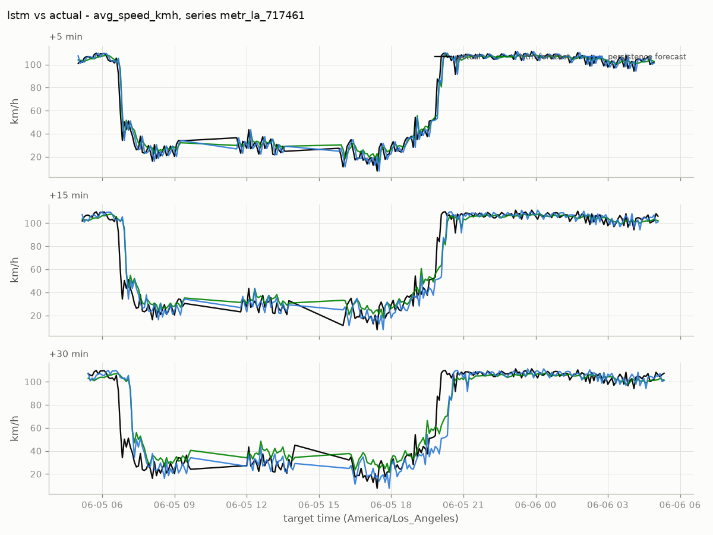
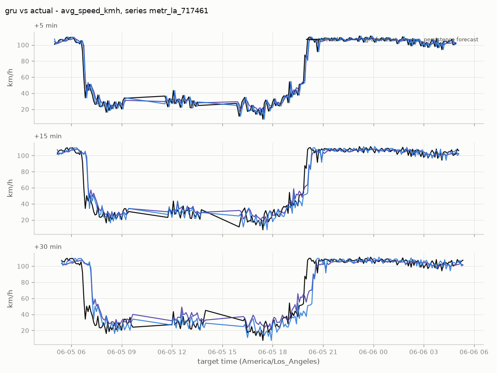
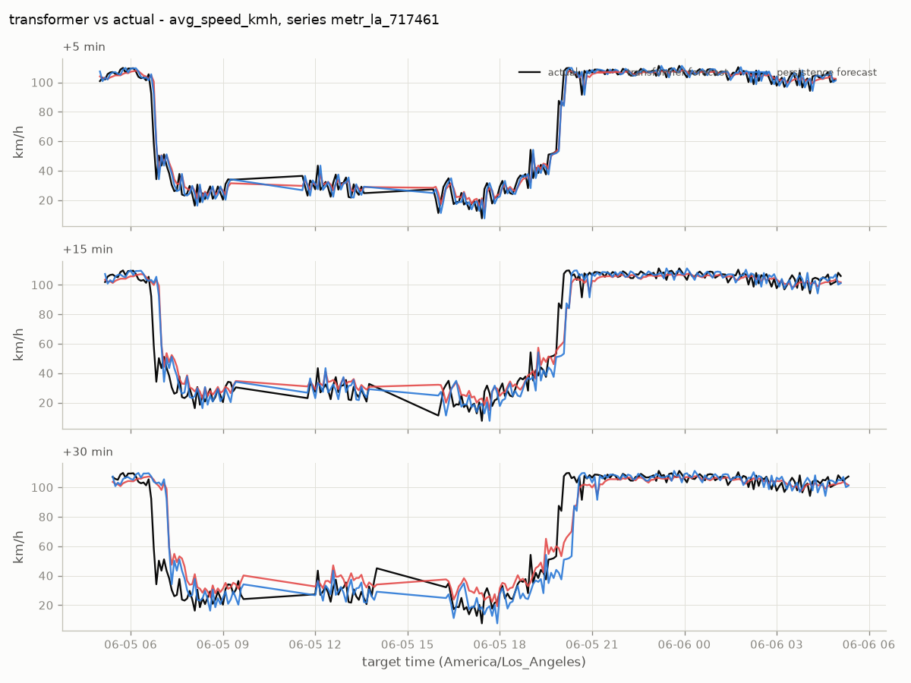
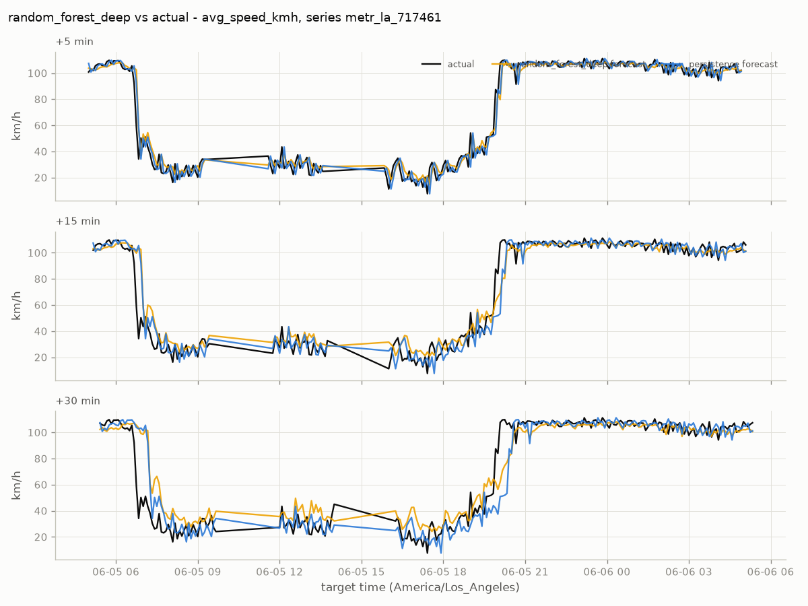
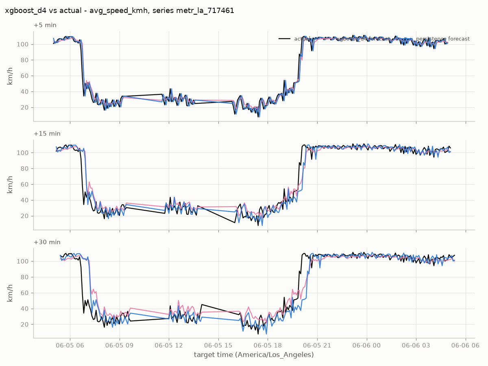
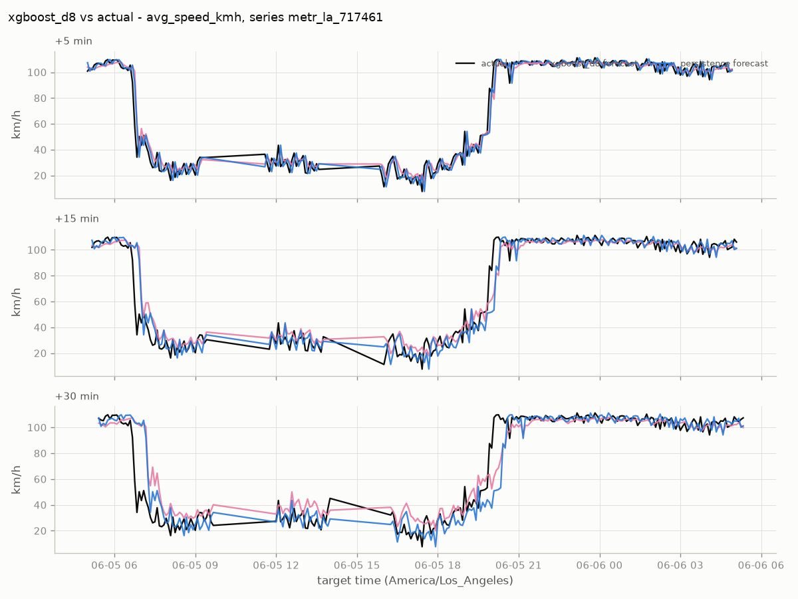

# Forecasting experiment `20260925-025205_metr_la_traffic_only`

METR-LA speed forecasting at +5/+15/+30 min (traffic only: past speeds of the sensor). Chronological split, fit-on-train scaling, identical windows for every model.

- **Dataset:** metr_la (metr_la), 11 series, resolution 300 s
- **Periods (chronological):** train 2012-03-01T08:00:00+00:00 -> 2012-05-23T14:30:00+00:00; val 2012-05-23T14:30:00+00:00 -> 2012-06-04T11:55:00+00:00; test 2012-06-04T11:55:00+00:00 -> 2012-06-28T07:00:00+00:00
- **Samples:** {'train': 240241, 'val': 32543, 'test': 61657} (identical test origins for every model)
- **Inputs (1):** avg_speed_kmh
- **Targets:** avg_speed_kmh; horizons [5, 15, 30] min
- **Model selection:** by validation RMSE on `avg_speed_kmh` -> **transformer**

## avg_speed_kmh (km/h) - test, averaged over horizons

| model | MAE | RMSE | R2 | MAPE | skill |
|---|---|---|---|---|---|
| transformer | 6.238 | 10.7 | 0.785 | 10.5 | 0.082 |
| gru | 6.236 | 10.7 | 0.784 | 10.5 | 0.082 |
| lstm | 6.275 | 10.7 | 0.784 | 10.6 | 0.081 |
| random_forest | 6.301 | 10.7 | 0.782 | 10.7 | 0.077 |
| xgboost | 6.302 | 10.8 | 0.782 | 10.6 | 0.076 |
| xgboost_d8 | 6.297 | 10.8 | 0.782 | 10.6 | 0.076 |
| xgboost_d4 | 6.311 | 10.8 | 0.782 | 10.7 | 0.076 |
| random_forest_deep | 6.349 | 10.8 | 0.781 | 10.7 | 0.076 |
| linear | 6.523 | 11.0 | 0.773 | 11.1 | 0.055 |
| persistence | 6.697 | 11.6 | 0.745 | 10.4 | 0.000 |
| seasonal_naive | 10.6 | 19.6 | 0.311 | 18.2 | -0.764 |

## avg_speed_kmh by horizon (test)

**+5 min**

| model | MAE | RMSE | R2 | MAPE | skill |
|---|---|---|---|---|---|
| lstm | 4.742 | 7.778 | 0.891 | 7.468 | 0.089 |
| gru | 4.760 | 7.780 | 0.891 | 7.447 | 0.089 |
| transformer | 4.757 | 7.792 | 0.891 | 7.379 | 0.087 |
| random_forest_deep | 4.796 | 7.824 | 0.890 | 7.494 | 0.084 |
| random_forest | 4.792 | 7.827 | 0.890 | 7.477 | 0.083 |
| xgboost | 4.783 | 7.833 | 0.890 | 7.462 | 0.082 |
| xgboost_d8 | 4.781 | 7.835 | 0.889 | 7.460 | 0.082 |
| xgboost_d4 | 4.792 | 7.838 | 0.889 | 7.475 | 0.082 |
| linear | 5.050 | 8.114 | 0.881 | 7.868 | 0.049 |
| persistence | 5.333 | 8.536 | 0.869 | 7.881 | 0.000 |
| seasonal_naive | 10.5 | 19.5 | 0.318 | 18.1 | -1.279 |

**+15 min**

| model | MAE | RMSE | R2 | MAPE | skill |
|---|---|---|---|---|---|
| transformer | 6.271 | 10.8 | 0.790 | 10.4 | 0.076 |
| gru | 6.192 | 10.8 | 0.789 | 10.4 | 0.074 |
| lstm | 6.241 | 10.8 | 0.789 | 10.5 | 0.074 |
| random_forest | 6.262 | 10.9 | 0.787 | 10.5 | 0.070 |
| xgboost | 6.261 | 10.9 | 0.787 | 10.5 | 0.070 |
| xgboost_d8 | 6.258 | 10.9 | 0.786 | 10.5 | 0.069 |
| xgboost_d4 | 6.275 | 10.9 | 0.786 | 10.5 | 0.069 |
| random_forest_deep | 6.311 | 10.9 | 0.786 | 10.6 | 0.068 |
| linear | 6.453 | 11.1 | 0.779 | 10.9 | 0.053 |
| persistence | 6.657 | 11.7 | 0.753 | 10.3 | 0.000 |
| seasonal_naive | 10.6 | 19.6 | 0.312 | 18.2 | -0.671 |

**+30 min**

| model | MAE | RMSE | R2 | MAPE | skill |
|---|---|---|---|---|---|
| transformer | 7.687 | 13.4 | 0.675 | 13.6 | 0.084 |
| gru | 7.756 | 13.5 | 0.674 | 13.7 | 0.082 |
| lstm | 7.842 | 13.5 | 0.673 | 13.8 | 0.082 |
| random_forest | 7.850 | 13.5 | 0.670 | 14.0 | 0.078 |
| xgboost_d8 | 7.853 | 13.5 | 0.670 | 13.9 | 0.077 |
| xgboost | 7.863 | 13.5 | 0.670 | 14.0 | 0.077 |
| xgboost_d4 | 7.867 | 13.5 | 0.669 | 14.0 | 0.077 |
| random_forest_deep | 7.939 | 13.6 | 0.668 | 14.1 | 0.075 |
| linear | 8.067 | 13.8 | 0.658 | 14.4 | 0.061 |
| persistence | 8.101 | 14.7 | 0.612 | 13.0 | 0.000 |
| seasonal_naive | 10.7 | 19.7 | 0.302 | 18.4 | -0.341 |

## Seed variability of deep models (avg_speed_kmh, test RMSE, mean over horizons)

| model | mean | std | min | max | seeds |
|---|---|---|---|---|---|
| gru | 11.0 | 0.023 | 10.9 | 11.0 | 2 |
| lstm | 10.9 | 0.011 | 10.9 | 10.9 | 2 |
| transformer | 11.0 | 0.043 | 10.9 | 11.0 | 2 |

The tables above use, for each deep model, the seed with the best *validation* RMSE.

## Observations (derived automatically from the numbers above)

- +5 min: lowest test RMSE = **lstm** (7.778); persistence 8.536; linear 8.114
- +15 min: lowest test RMSE = **transformer** (10.8); persistence 11.7; linear 11.1
- +30 min: lowest test RMSE = **transformer** (13.4); persistence 14.7; linear 13.8
- Best deep model transformer vs best tree model random_forest: RMSE 10.7 vs 10.7 (deep better by 0.6%).
- Best tree model random_forest vs linear baseline: +2.2% RMSE reduction.
- Models beating persistence on average: linear, random_forest, xgboost, lstm, gru, transformer, random_forest_deep, xgboost_d4, xgboost_d8.
- Deep models whose mean-over-seeds RMSE (+1 std) is below the best tree model (random_forest): none.

## Training cost

| model | family | fit (s) | predict (ms/sample) | epochs | parameters |
|---|---|---|---|---|---|
| persistence | baseline | 0.0 | 0.0001 | - | - |
| seasonal_naive | baseline | 0.0 | 0.0002 | - | - |
| linear | linear | 1.34 | 0.0008 | - | - |
| random_forest | tree | 4.18 | 0.0034 | - | - |
| xgboost | tree | 3.48 | 0.0011 | - | - |
| lstm | deep | 48.62 | 0.0016 | 27 | 50755 |
| gru | deep | 59.07 | 0.002 | 32 | 38147 |
| transformer | deep | 121.95 | 0.0044 | 24 | 67715 |
| random_forest_deep | tree | 6.07 | 0.0045 | - | - |
| xgboost_d4 | tree | 5.51 | 0.0015 | - | - |
| xgboost_d8 | tree | 4.65 | 0.001 | - | - |

## Figures

