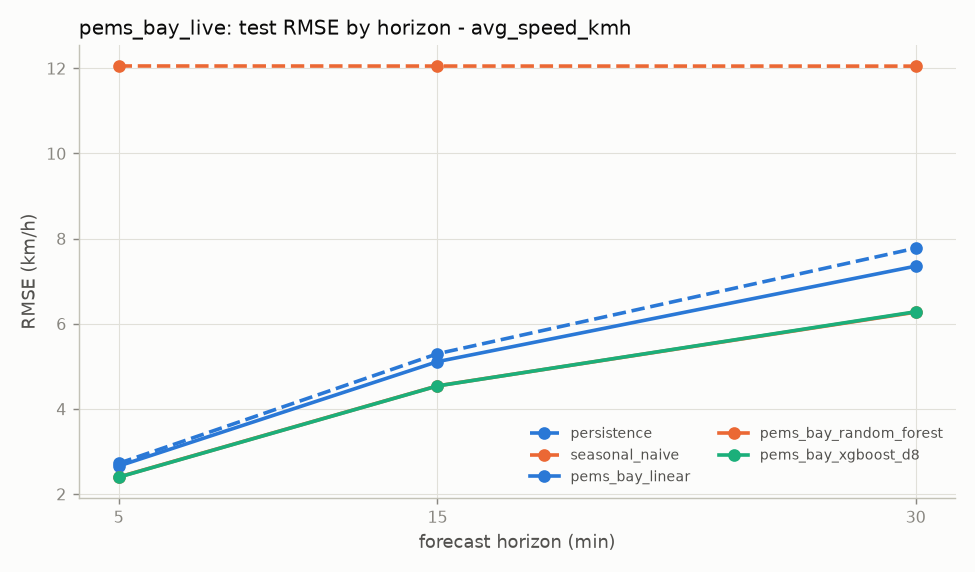
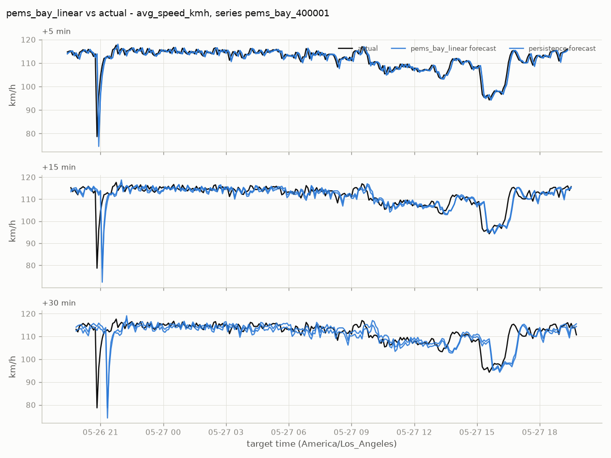
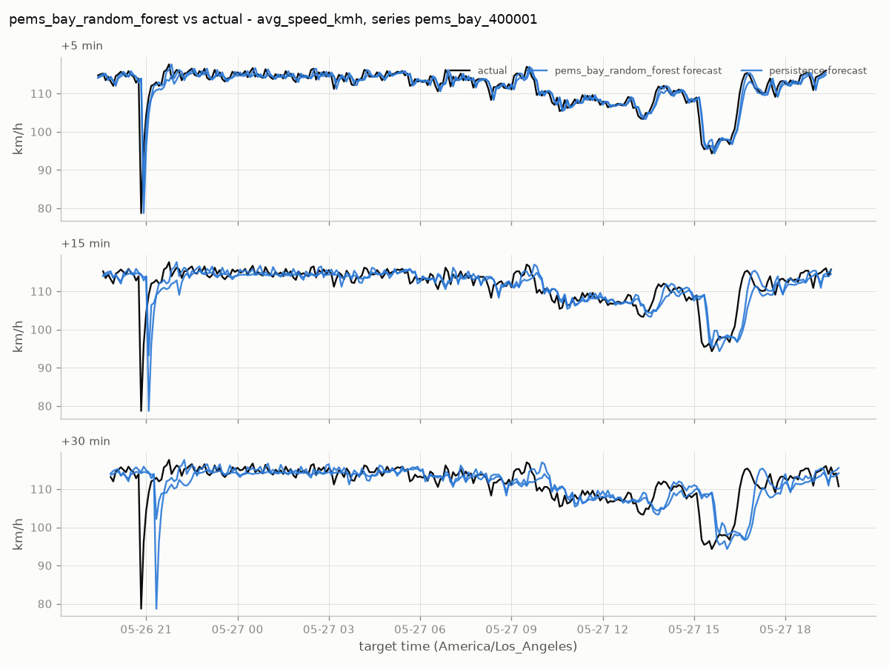
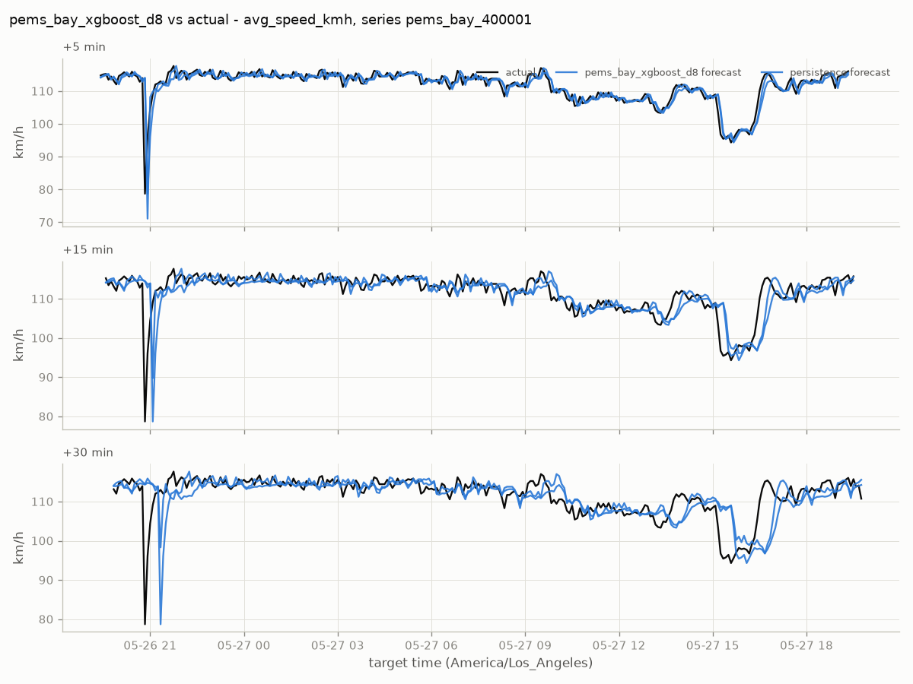

# Forecasting experiment `20260930-031242_pems_bay_live`

PEMS-BAY speed forecasting at +5/+15/+30 min for the real-data runtime mode (speed + calendar). Chronological split, fit-on-train scaling, identical windows for every model.

- **Dataset:** pems_bay (pems_bay), 109 series, resolution 300 s
- **Periods (chronological):** train 2017-01-01T08:00:00+00:00 -> 2017-05-08T00:05:00+00:00; val 2017-05-08T00:05:00+00:00 -> 2017-05-26T02:20:00+00:00; test 2017-05-26T02:20:00+00:00 -> 2017-07-01T07:00:00+00:00
- **Samples:** {'train': 3974576, 'val': 567345, 'test': 1135562} (identical test origins for every model)
- **Inputs (8):** avg_speed_kmh, hour_sin, hour_cos, dow_sin, dow_cos, is_weekend, is_holiday, is_rush_hour
- **Targets:** avg_speed_kmh; horizons [5, 15, 30] min
- **Model selection:** by validation RMSE on `avg_speed_kmh` -> **pems_bay_random_forest**

## avg_speed_kmh (km/h) - test, averaged over horizons

| model | MAE | RMSE | R2 | MAPE | skill |
|---|---|---|---|---|---|
| pems_bay_random_forest | 2.157 | 4.405 | 0.906 | 2.903 | 0.151 |
| pems_bay_xgboost_d8 | 2.163 | 4.406 | 0.905 | 2.899 | 0.151 |
| pems_bay_linear | 2.543 | 5.041 | 0.875 | 3.378 | 0.038 |
| persistence | 2.442 | 5.264 | 0.862 | 3.129 | 0.000 |
| seasonal_naive | 5.201 | 12.1 | 0.374 | 7.425 | -1.752 |

## avg_speed_kmh by horizon (test)

**+5 min**

| model | MAE | RMSE | R2 | MAPE | skill |
|---|---|---|---|---|---|
| pems_bay_xgboost_d8 | 1.356 | 2.397 | 0.975 | 1.625 | 0.119 |
| pems_bay_random_forest | 1.359 | 2.400 | 0.975 | 1.633 | 0.118 |
| pems_bay_linear | 1.525 | 2.658 | 0.970 | 1.815 | 0.023 |
| persistence | 1.503 | 2.722 | 0.968 | 1.783 | 0.000 |
| seasonal_naive | 5.203 | 12.1 | 0.374 | 7.427 | -3.429 |

**+15 min**

| model | MAE | RMSE | R2 | MAPE | skill |
|---|---|---|---|---|---|
| pems_bay_xgboost_d8 | 2.200 | 4.540 | 0.911 | 2.909 | 0.143 |
| pems_bay_random_forest | 2.197 | 4.542 | 0.911 | 2.920 | 0.142 |
| pems_bay_linear | 2.555 | 5.111 | 0.887 | 3.329 | 0.035 |
| persistence | 2.463 | 5.296 | 0.879 | 3.123 | 0.000 |
| seasonal_naive | 5.201 | 12.1 | 0.374 | 7.425 | -1.276 |

**+30 min**

| model | MAE | RMSE | R2 | MAPE | skill |
|---|---|---|---|---|---|
| pems_bay_random_forest | 2.917 | 6.273 | 0.830 | 4.156 | 0.193 |
| pems_bay_xgboost_d8 | 2.934 | 6.282 | 0.830 | 4.163 | 0.192 |
| pems_bay_linear | 3.548 | 7.353 | 0.767 | 4.989 | 0.054 |
| persistence | 3.361 | 7.775 | 0.739 | 4.482 | 0.000 |
| seasonal_naive | 5.200 | 12.1 | 0.374 | 7.423 | -0.550 |

## Observations (derived automatically from the numbers above)

- +5 min: lowest test RMSE = **pems_bay_xgboost_d8** (2.397); persistence 2.722
- +15 min: lowest test RMSE = **pems_bay_xgboost_d8** (4.540); persistence 5.296
- +30 min: lowest test RMSE = **pems_bay_random_forest** (6.273); persistence 7.775
- Models beating persistence on average: pems_bay_linear, pems_bay_random_forest, pems_bay_xgboost_d8.

## Training cost

| model | family | fit (s) | predict (ms/sample) | epochs | parameters |
|---|---|---|---|---|---|
| persistence | baseline | 0.0 | 0.0007 | - | - |
| seasonal_naive | baseline | 0.0 | 0.0009 | - | - |
| pems_bay_linear | linear | 3.38 | 0.0023 | - | - |
| pems_bay_random_forest | tree | 347.4 | 0.0091 | - | - |
| pems_bay_xgboost_d8 | tree | 85.53 | 0.0096 | - | - |

## Figures

